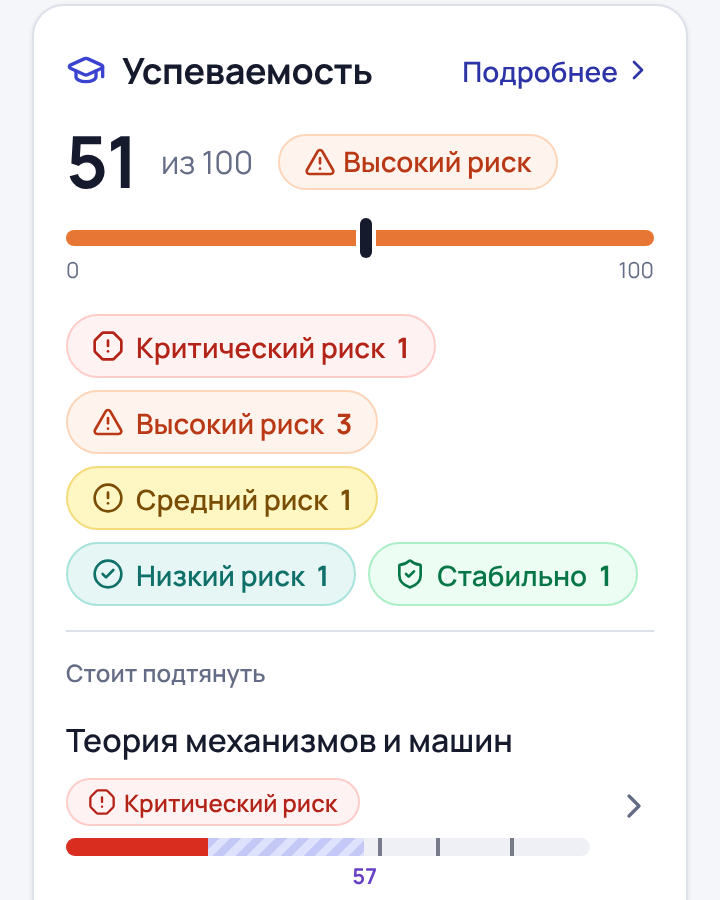
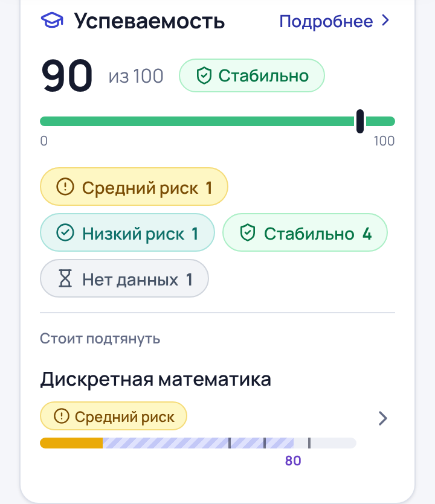
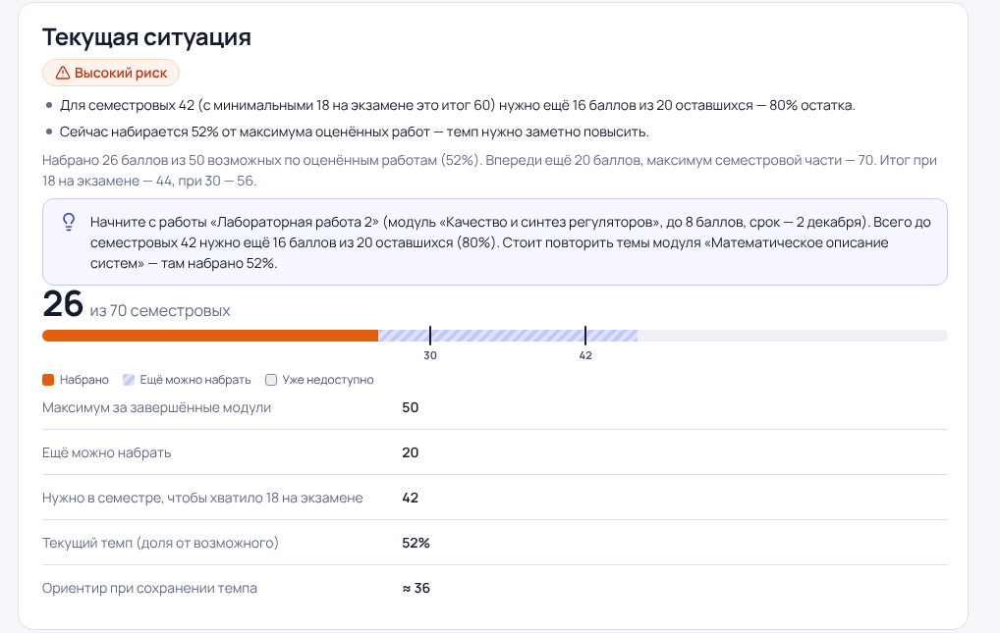
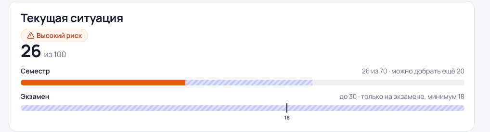
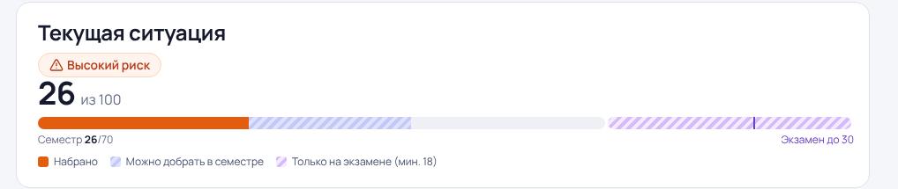
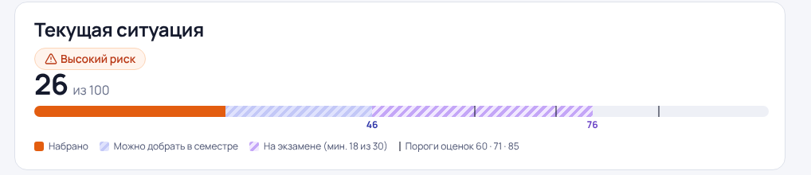

# Цифровой деканат — личный кабинет студента (концепт)

> **Концепт, созданный для конкурса «Цифровой деканат будущего». Не является официальным сервисом университета.**
> Все ФИО, группы, оценки, номера зачёток и обращения вымышлены.

**Автор:** Сироткин Игорь — студент 3 курса МГТУ им. Н. Э. Баумана, кафедра ИУ6 «Компьютерные системы и сети»,
направление «Системы искусственного интеллекта». Команда **Bauman Analytics**.

Веб-приложение собирает учебную жизнь студента в одном месте: расписание с изменениями, успеваемость по
балльно-рейтинговой системе с **анализом риска по каждому предмету**, проверенные материалы по слабым темам, заявки и
справки со статусами, связь с деканатом и уведомления. Полноценно работает на телефоне (от 360 px). Весь код написан
ИИ-агентами (ChatGPT → Claude Code), автор ставил задачи, проверял и направлял — см. [краткий отчёт](#как-создавался-проект--кратко).

 

## Демо-доступ
**Ссылка на прототип** — в комментарии к работе (развёрнут на VPS автора, HTTPS). Подробный маршрут проверки —
[инструкция для жюри](docs/jury-instructions.md).

| Роль | Логин | Пароль | Что посмотреть |
|---|---|---|---|
| Студентка, 2 курс, ИУ5-34Б — учёба стабильна | `student1` | `student1-demo` | успеваемость 90 «Стабильно», «Дискретная математика» требует внимания, по английскому — «недостаточно данных», готовая справка |
| Студент, 3 курс, РК9-51Б — зона риска | `student2` | `student2-demo` | успеваемость 51 «Высокий риск», ТММ — критический риск, три дисциплины высокого риска, заявка «требуется уточнение» |
| Сотрудник деканата | `dekanat` | `dekanat-demo` | очередь заявок, смена статусов, ответы, просмотр успеваемости (факультет → кафедра → группа → студент), объявления |

Пароли — тестовые, задаются переменными окружения при первом заполнении БД (см. `.env.example`).

## Чем проект отличается

Главная идея — кабинет не просто показывает баллы, а **отвечает на вопрос «что мне делать»**. Она выросла из опыта
автора: в его вузе есть раздел «текущая успеваемость» с баллами по модулям, но по нему не понятно, насколько всё
плохо и что подтянуть первым.

1. **«Успеваемость» — одно число 0–100 с цветовой зоной** («Стабильно», «Требует внимания», «Высокий риск», «Критично»).
   Считается как среднее баллов уровней риска по дисциплинам с **ограничениями сверху**: если есть критический
   предмет, число не выше 59, — так одна проблемная дисциплина не теряется среди благополучных. Под кнопкой
   **«Что это такое?»** объяснено, как получено число.
2. **Риск по каждой дисциплине для трёх типов аттестации БРС** — зачёт (60 из 100), распределённый экзамен
   (0–100 за семестр) и экзамен (до 70 за семестр + 18…30 на экзамене, минимум 18 обязателен). Учитываются набранные
   баллы, остаток, темп и достижимость; если данных мало, честно пишется «Недостаточно данных».
3. **Единая шкала «семестр + экзамен»** на оси 0–100: набрано → можно добрать в семестре → экзамен без разрыва →
   недоступно; подписаны потолок семестра и максимальный итог, отмечены пороги оценок 60/71/85. Одна и та же шкала —
   на странице предмета, в списке дисциплин и на главной.
4. **Достижимость оценок:** для «удовл», «хор» и «отл» — достижимо или нет и **сколько добрать в семестре и сколько
   получить на экзамене** (план с минимальным экзаменом).
5. **«Что если?»** — симулятор: вводишь ожидаемые баллы (или «Заполнить минимумом» — 60 % от максимума каждой
   работы — / «максимумом») и сразу видишь итоговую оценку. Ничего не сохраняется.
6. **«✨ Подсказка ИИ»** — короткий вывод о темпе и список предметов, которые стоит подтянуть. Формируется
   алгоритмом анализа внутри сервиса — данные студента не отправляются во внешние нейросети, ключи API не нужны.
7. **Проверенные материалы по слабым темам:** 142 ссылки на открытые ресурсы для 63 тем учебного плана; каждую ссылку
   ИИ-агент открыл и проверил, у каждой — «Почему рекомендовано» и дата проверки. Темы модулей с низкими баллами
   помечены «стоит повторить».
8. **Расписание с изменениями:** отмены, переносы «откуда → куда», замены аудитории и преподавателя, дополнительные
   занятия — выделены и цветом, и подписью; числитель/знаменатель.
9. **Заявки как в хорошем сервисе:** 7 типов, динамические формы с проверкой, черновики, 9 статусов с подсказкой
   «что дальше», история, переписка с деканатом, электронный документ-образец.
10. **Удобная навигация:** уведомление открывается окном с «Подробнее»; «Назад» возвращает туда, откуда пришёл
    (уведомления, расписание, сессия), и на то же место страницы.
11. **Кабинет деканата:** очередь заявок с допустимыми переходами статусов, объявления для групп и факультетов,
    просмотр успеваемости по факультетам, кафедрам и группам (только чтение — баллы ставит преподаватель).
12. **Безопасность и качество:** пароли argon2id, серверные сессии, CSRF, чужой ресурс → 404, лимит попыток входа,
    CSP; **224 автотеста** и **277 браузерных проверок** (в том числе атакующих) проходят.

## Возможности по разделам
- **Вход/выход**, защищённые серверные сессии, профиль студента.
- **Главная:** занятия сегодня, прогресс семестра, «Успеваемость» и «Стоит подтянуть», ближайшие сроки, активные заявки, уведомления, быстрые действия.
- **Расписание:** день/неделя, числитель/знаменатель, все виды изменений.
- **Учёба:** «Успеваемость» (число, зоны, подсказка ИИ, дисциплины по типу аттестации), карточка дисциплины (шкала,
  достижимость 60/71/85, модули и работы, «Что если»), темы и материалы, сессия, зачётная книжка.
- **Заявки:** справки, заявления, обращение в деканат; статусы, история, переписка, документ.
- **Уведомления:** объявления, сроки, изменения расписания, статусы заявок, новые баллы; прочитанные/непрочитанные.
- **Кабинет деканата:** заявки, ответы, объявления, просмотр успеваемости студентов.

## Как создавался проект — кратко

Полный отчёт: [docs/ai_development_report.md](docs/ai_development_report.md) ([PDF со скриншотами](docs/ai_development_report.pdf)).

```
 Автор ──► ChatGPT (4 промпта) ──► ТЗ v2 (62 тыс. знаков) + 8 ролей агентов + стартовый промпт
                                          │
                                          ▼
          Claude Code, Claude Opus 5.5 — координатор (роли 00 + 02: план, контракты, backend)
            ├─► 04 Аналитика ........ модуль риска и индекса + 148 тестов
            ├─► 05 Материалы ........ 142 проверенные ссылки (WebSearch + WebFetch)
            ├─► 01 Продукт и UX ..... сценарии, карта экранов, решения
            ├─► 03 Frontend ......... дизайн-система, SPA
            ├─► 06 QA (независимо) .. 50 API-атак + 277 браузерных проверок → 12 дефектов
            └─► 07 Документация ..... отчёт об ИИ-разработке
                                          │
                                          ▼
          Автор тестирует вручную (Windows, VPS, телефон) ──► 7 сообщений с правками ──► ИИ исправляет
```

**1. Постановка задачи (ChatGPT).** Автор не начинал с «сделай кабинет». Четырьмя промптами он превратил условия
конкурса в ТЗ для ИИ-модели, добавил реалии своего вуза (БРС, три типа аттестации) и «киллер-фичу» анализа
успеваемости, получил инструкции для 8 ролей агентов и короткий стартовый промпт — без дублирования ТЗ
([все промпты дословно](docs/ai-log/00a_chatgpt_spec_prompts.md)). Пример промпта 2:
> «…дополнительной функцией (киллер-фичой) будет алгоритм, который смотрит баллы студента, выделяет предметы в
> красной зоне… и в целом оценивают ситуацию, насколько все плохо (желательно в графической форме…)… В соответствии с
> этим измени основной md-файл и дай файлы md для ролей, чтобы я мог скинуть все эти файлы основной нейросети.»

**2. Контракты до параллельной работы.** Координатор сначала зафиксировал учебный план (14 дисциплин, 63 темы),
контракт аналитики и демо-баллы с **заранее посчитанными вручную** ожидаемыми рисками и индексами (90 и 51). Агенты
работали параллельно, каждый — только в своей зоне файлов («Изменяй ТОЛЬКО…»), и результат сверялся с эталоном:
все 14 уровней риска и оба индекса совпали без подгонки.

**3. Промпты субагентам** построены по одному шаблону: роль → контекст с путями к файлам → неизменяемые решения →
задача с проверяемыми критериями → запреты («Не выдумывай названия, авторов, ссылки…», «Пустая подборка лучше
фиктивной») → обязательная самопроверка → отчёт с отклонениями от контракта
([промпты и отчёты агентов](docs/ai-log/)).

**4. Ничего не принималось на слово.** Независимый прогон тестов, скрипты проверки данных, `tsc`, Playwright на
360/1280 px, просмотр скриншотов «глазами» ИИ, сверка фактов документов с данными, сборка Docker из чистого клона.
Независимый QA-агент («найти дефекты, а не подтвердить, что всё хорошо») нашёл 12 дефектов — все исправлены и
подтверждены ретестом.

**5. Ошибки ИИ и их исправление** (полная таблица — в отчёте, 11.3.4):

| Что пошло не так | Кто заметил | Итог |
|---|---|---|
| Агент выдумал даты изменений расписания в продуктовом документе | сверка фактов координатором | исправлено по эталону |
| Гонка в уведомлениях → HTTP 500 | e2e-обход | транзакция SAVEPOINT + регрессионный тест |
| Обход лимита входа через `X-Forwarded-For`, 500 на граничном вводе и др. | независимый QA | 12 дефектов закрыто |
| Демо-данные не попадали в git (`.gitignore`) | агент-документатор | исправлено, образ собран из чистого клона |
| `entrypoint.sh` с CRLF не запускался на Windows | автор | `.gitattributes` + очистка при сборке |
| Две шкалы вместо одной, затем фиксированный участок 70–100 | автор (2 раза) | единая ось 0–100 после разбора на примере |
| Деканат мог ставить баллы — нелогично для вуза | автор | права записи удалены на сервере |

**6. Человек в контуре.** Автор сам запускал каждую версию и прислал 7 сообщений с правками
([все правки и разбор](docs/ai-log/07_user_feedback.md)). Автотесты проверяли, что всё *работает*; автор — что всё
*удобно и логично*. Как менялась шкала дисциплины:

| Версия 1 — много текста | Версия 2 — две шкалы | Версия 3 — фиксированные 70/30 | Итог — единая ось |
|---|---|---|---|
|  |  |  |  |

**7. Итог проверок:** 224 автотеста backend, 277 браузерных проверок на 360/390/768/1280 px, smoke-обход 25 экранов
без ошибок консоли и горизонтальной прокрутки — после каждой итерации.

**Что делал автор вручную:** постановка задачи и подготовка ТЗ в ChatGPT, ручное тестирование и правки, репозиторий
GitHub, хостинг на своём VPS. Код вручную не писался.

## Стек
FastAPI · SQLAlchemy 2 · Alembic · SQLite/PostgreSQL · argon2id · React 18 · TypeScript · Vite · React Router ·
TanStack Query · pytest · Playwright · Docker. Обоснование — [docs/architecture.md](docs/architecture.md).

## Структура
```
backend/
  app/
    api/            эндпоинты: auth, student, applications, notifications, staff, meta
    security/       сессии, CSRF, argon2id, роли, лимит входа
    services/       расписание, заявки (типы/статусы), уведомления, адаптер аналитики
    domain/analytics/  детерминированный модуль аналитики успеваемости (+ config.py с порогами)
    seed/           вымышленные демо-данные и каталог учебных материалов (data/*.json)
    models.py, config.py, main.py, bootstrap.py
  migrations/       Alembic
  tests/            API, безопасность/IDOR, сценарии; tests/domain — аналитика
frontend/
  src/              React-приложение (api/, components/, pages/, styles/)
  e2e/smoke.py      Playwright-проверка сценариев на 360 px и десктопе
docs/               ТЗ, архитектура, модель данных, API, безопасность, аналитика, UX, тестирование, отчёт об ИИ
Dockerfile, docker-compose.yml, amvera.yml, deploy/
```

## Локальный запуск
**Docker (проще всего):**
```bash
docker compose up --build        # → http://localhost:8000
```
**Без Docker:**
```bash
# backend (Python 3.12+)
cd backend
python -m venv .venv && . .venv/bin/activate
pip install -r requirements-dev.txt
uvicorn app.main:app --reload --port 8000        # миграции и демо-данные применятся при старте

# frontend (Node 20+), в другом терминале
cd frontend
npm ci
npm run dev                                       # → http://localhost:5173 (проксирует /api на :8000)
```
Сборка frontend для раздачи backend-ом: `cd frontend && npm run build` → `http://localhost:8000`.

## База данных и демо-данные
- Схема — миграции Alembic (`backend/migrations`), применяются автоматически при старте.
- Пустая БД заполняется демо-данными при старте (`SEED_ON_STARTUP=true`).
- Вручную: `cd backend && python -m app.seed` · пересоздать: `python -m app.seed --reset`.
- По умолчанию SQLite (`backend/data/deanate.db`, в Docker — `/data/deanate.db`); PostgreSQL — `DATABASE_URL=postgresql://…`.

## Тесты
```bash
(cd backend && python -m pytest -q)               # домен аналитики + API + безопасность

# сценарии в браузере (Playwright + Google Chrome в /usr/bin/google-chrome), из корня репозитория:
(cd backend && DEMO_TODAY=2026-11-23 uvicorn app.main:app --port 8000)   # сервер с фиксированной датой демо
python frontend/e2e/smoke.py http://127.0.0.1:8000                       # в другом терминале
```
`smoke.py` проходит 25 экранов на 360 и 1280 px, проверяет горизонтальную прокрутку и ошибки консоли и перезаписывает
скриншоты в `docs/screenshots/`. Результаты тестирования — [docs/test-report.md](docs/test-report.md).

## Публикация
Инструкции для Amvera Cloud, VPS и любого Docker-хостинга — [docs/deploy.md](docs/deploy.md).

## Документация
- **Для жюри:** [Инструкция для жюри](docs/jury-instructions.md) ·
  [Отчёт об ИИ-разработке](docs/ai_development_report.md) ([PDF со скриншотами](docs/ai_development_report.pdf)) ·
  [Промпты ChatGPT для ТЗ](docs/ai-log/00a_chatgpt_spec_prompts.md) · [Правки автора](docs/ai-log/07_user_feedback.md) ·
  [Журнал процесса](docs/ai-log/process-log.md) · [Промпты и отчёты агентов](docs/ai-log/) · [Скриншоты](docs/screenshots/)
- **Продукт и UX:** [Продуктовые решения](docs/product-decisions.md) · [Сценарии](docs/user-journeys.md) ·
  [Информационная архитектура](docs/information-architecture.md) · [UX аналитики](docs/analytics-ux.md) ·
  [UX-бриф экранов](docs/ux-brief.md) · [Дизайн-система](docs/design-system.md)
- **Техника:** [Допущения](docs/assumptions.md) · [Архитектура](docs/architecture.md) · [Модель данных](docs/data-model.md) ·
  [API](docs/api-contract.md) и [примеры ответов](docs/api-examples/) · [Безопасность](docs/security.md) ·
  [Публикация](docs/deploy.md) · [Тестирование](docs/test-report.md)
- **Аналитика и материалы:** [Контракт аналитики](docs/analytics-contract.md) · [Модель аналитики](docs/analytics-model.md) ·
  [Учебные материалы](docs/learning-resources.md)
- **Исходные требования:** [ТЗ](docs/source/technical_spec_digital_deanate_v2.md) · [Роли агентов](docs/source/agent_roles/)

PDF отчёта собирается из Markdown: `python3 docs/report-build/build_pdf.py` (нужны `markdown`, `playwright` и Chrome).

## Сторонние материалы и лицензии
React, React Router, TanStack Query, Vite, TypeScript — MIT; иконки lucide — ISC; шрифт Manrope — SIL Open Font License 1.1;
FastAPI, Starlette, Pydantic — MIT; SQLAlchemy, Alembic — MIT; argon2-cffi — MIT; Uvicorn — BSD-3-Clause; psycopg — LGPL-3.0.
Учебные материалы — ссылки на открытые внешние ресурсы (контент не копируется), см. [docs/learning-resources.md](docs/learning-resources.md).
Логотип — собственный, не воспроизводит символику какого-либо вуза.
