# Отчёт об использовании ИИ при создании прототипа «Цифровой деканат будущего»

> **Концепт, созданный для конкурса «Цифровой деканат будущего». Не является официальным сервисом университета.**
> Все ФИО, группы, оценки и обращения в прототипе вымышлены.

**Автор проекта:** Сироткин Игорь — студент 3 курса МГТУ им. Н. Э. Баумана, кафедра ИУ6 «Компьютерные системы и
сети», направление «Системы искусственного интеллекта»; команда **Bauman Analytics**.

**Что это за документ.** Описание того, как прототип личного кабинета студента создавался с помощью ИИ: как автор
готовил ТЗ в ChatGPT, какие инструменты и агенты работали, какими промптами ставились задачи, как проверялись
результаты, какие ошибки допустил ИИ и как автор и ИИ их нашли и исправили. Первую версию подготовил
агент-документатор (роль 07), после итераций с автором отчёт дополнил координатор (22.11.2026). Опирается он только на
проверяемые артефакты: промпты автора ([`ai-log/00a_chatgpt_spec_prompts.md`](ai-log/00a_chatgpt_spec_prompts.md)),
журнал координатора ([`ai-log/process-log.md`](ai-log/process-log.md)), правки автора
([`ai-log/07_user_feedback.md`](ai-log/07_user_feedback.md)), промпты и отчёты субагентов в [`ai-log/`](ai-log/),
историю git (12 коммитов), код и скриншоты. Если какого-то артефакта нет, это сказано прямо. PDF-версия:
[`ai_development_report.pdf`](ai_development_report.pdf).

## Коротко

- **Цепочка ИИ:** ChatGPT → Claude Code. Автор за **4 промпта** в ChatGPT превратил условия конкурса и особенности
    своего вуза (балльно-рейтинговая система, три типа аттестации) в ТЗ для ИИ-модели (≈ 62 тыс. знаков, 20 разделов),
    8 инструкций для ролей агентов и короткий стартовый промпт. Затем Claude Code (модель Claude Opus 5.5) в режиме
    агента с субагентами написал весь продукт.
- **Организация:** **7 агентов**. Координатор вёл проект и сам написал backend (роли 00 и 02), шесть субагентов
    получили роли 01, 03, 04, 05, 06 и 07. Сначала координатор зафиксировал контракты между частями системы с
    эталонными ответами, затем агенты работали параллельно, у каждого была своя зона файлов.
- **Человек в контуре:** автор сам тестировал каждую версию (Docker на Windows, затем свой VPS, телефон) и прислал
    **7 сообщений с правками** — от «назад ведёт не туда» до «деканату нелогично ставить баллы». В трёх случаях ИИ
    понял задачу неправильно и исправлял её повторно (раздел 11.4).
- **Проверки:** **224 автотеста** backend (148 — аналитика, 26 — API и сценарии, 50 — независимый QA); браузерные
    сценарии QA — **277 проверок, все PASS** на 360/390/768/1280 px; smoke-обход 25 экранов на 360 и 1280 px без
    горизонтальной прокрутки и ошибок консоли. Прогон повторялся после каждой итерации.
- **Ошибки ИИ найдены и исправлены:** самопроверкой, сверкой фактов, e2e, независимым QA (12 дефектов) и автором
    (CRLF в Docker, 3 случая неверного понимания задачи) — 18 случаев в 11.3.4 и 11.4.
- **Публикация:** код — GitHub `seerigorsss/digital-deanate`; прототип автор развернул на своём VPS (Docker + Caddy,
    HTTPS). Ссылка и аккаунты — в комментарии к работе и в [`jury-instructions.md`](jury-instructions.md).

## Как устроен документ

Основные разделы пронумерованы 11.1–11.4: так их назвал координатор в постановке для документатора. В ТЗ
обязательное содержание описания процесса перечислено в §10.3, а критерий жюри «Масштаб использования
нейротехнологий» — это §11.2.

| Раздел отчёта | ТЗ §10.3 (обязательное содержание) | Что оценивает критерий ТЗ §11.2 |
|---|---|---|
| 0. Подготовка ТЗ и ролей в ChatGPT | п. 3 «Промпты и диалоги» | качество постановки задач, структура документов для агентов |
| 1. Проблема и продуктовая идея | п. 1 «Проблема и продуктовая идея» | осмысленность применения ИИ |
| 11.1 Подход | п. 2 «Инструменты», п. 6 «Ручная работа» | широта применения, продуманность процесса |
| 11.2 Промпты и диалоги | п. 3 «Промпты и диалоги» | качество промптов, работа с субагентами |
| 11.3 Процесс | п. 4 «Ход разработки», п. 5 «Архитектура и безопасность» | работа с ошибками и ограничениями ИИ |
| 11.4 Итерации с автором | п. 4 (удачные и неудачные варианты), п. 6 | работа с ошибками ИИ, наглядность |
| Скриншоты | п. 4 (скриншоты) | наглядность описания |

---

## 0. Подготовка ТЗ и ролей в ChatGPT (до разработки)

Разработку не начинали с «сделай мне кабинет». Сначала автор в ChatGPT подготовил **документы для ИИ-агентов** —
так, чтобы основная модель работала по спецификации, а не по догадкам. Полные тексты промптов —
[`ai-log/00a_chatgpt_spec_prompts.md`](ai-log/00a_chatgpt_spec_prompts.md).

```
Условия конкурса ──► Промпт 1 ──► ТЗ v1 (md-файл для ИИ-модели)
Реалии вуза (БРС) ─► Промпт 2 ──► ТЗ v2 + «киллер-фича» аналитики + 8 файлов ролей agent_roles/
                     Промпт 3 ──► стартовый промпт для основной нейросети
                     Промпт 4 ──► тот же промпт без дублирования ТЗ (только ввод в контекст)
                                        │
                                        ▼
               Claude Code (Claude Opus 5.5): ТЗ v2 + agent_roles/ + стартовый промпт
```

| Промпт | Что попросил автор | Что получилось |
|---|---|---|
| 1 | «Собери данный текст в md-файл, удобный для отправки и чтения модели, сформировав ТЗ для ИИ-модели, которая будет решать задачу» + полный текст условий конкурса | ТЗ v1: требования конкурса, переписанные как задание для модели |
| 2 | Описал раздел «текущая успеваемость» своего вуза, шкалу 0–59/60–70/71–84/85–100 и три типа аттестации (зачёт; распределённый экзамен; экзамен 70 + 18…30). Попросил «киллер-фичу»: алгоритм, который находит предметы в красной зоне, оценивает ситуацию графически (шкала или круг, от красного к зелёному) и подбирает материалы по темам; и **файлы md для ролей** | ТЗ v2 с разделами §14–§19 (БРС, модель риска, индекс, подбор материалов, тестирование аналитики) и 8 ролей: координатор, продукт, архитектор, frontend/UX, аналитика, материалы, QA, документатор |
| 3 | «Хорошо, теперь преобразуй п. 3 в конкретный текстовый промпт, который мне нужно передать нейросети вместе с файлами» | стартовый промпт для основной модели |
| 4 | «Дублирует ли это то, что написано в основном md-файле? Если да, то убери все лишнее и оставь только то, что действительно нужно, чтобы ввести модель в контекст» | короткий промпт [`00_initial_prompt.txt`](ai-log/00_initial_prompt.txt): роль координатора, правила работы с ТЗ и ролями, требование довести проект до опубликованного прототипа |

**Почему так.** ТЗ — единственный источник требований; роли дают субагентам готовые зоны ответственности; стартовый
промпт без дублирования не тратит контекст и не создаёт двух расходящихся версий требований. Промпт 4 — пример
работы автора с ИИ: он сам заметил риск дублирования и попросил его убрать.

---

## 1. Проблема и продуктовая идея

**Проблема (ТЗ §1).** Учебная информация и административные процессы разбросаны по сайтам, чатам, почте и очным
визитам в деканат. Агент 01 в [`product-decisions.md`](product-decisions.md) уточнил эту проблему. Студент должен за
минуту и с телефона ответить себе на четыре вопроса:
1. что у меня сегодня и не изменилось ли что-то;
2. всё ли в порядке с учёбой и что сделать первым;
3. сколько ещё нужно набрать;
4. где мой документ.

**Откуда «киллер-фича».** Из опыта автора: в его вузе баллы по модулям видны в разделе «текущая успеваемость», но
он показывает только числа и не отвечает на вопрос «что делать». Поэтому центральная идея кабинета — **«Успеваемость»**:
сводное число 0–100 с цветовой зоной, уровень риска по каждой дисциплине, наглядная шкала «семестр + экзамен»,
сколько нужно набрать на 60/71/85, симулятор «Что если» и проверенные материалы по слабым темам.

**Почему выбраны именно эти разделы.** Обязательное ядро ТЗ: вход и профиль, главная, расписание с изменениями,
успеваемость, заявки, уведомления. К нему добавлены:
- **«Успеваемость»** — индекс, уровни риска, шкалы, нужные баллы, «Что если», подсказка ИИ (ТЗ §15);
- **подбор проверенных материалов** по слабым темам (ТЗ §16);
- **кабинет сотрудника деканата:** обработка заявок, объявления и **просмотр** успеваемости по
    факультетам, кафедрам и группам (без права менять баллы — по замечанию автора, раздел 11.4).

Решения D-01…D-17 с отклонёнными альтернативами описаны в `product-decisions.md`, раздел 5. В
[`user-journeys.md`](user-journeys.md) описано 10 сценариев (С1–С10).

**Исследование потребностей.** Формальных опросов однокурсников не проводилось. ИИ-агенту прямо запретили их
выдумывать: «Не придумывай опросы студентов и их результаты — если упоминаешь исследования, помечай как гипотезы для
проверки» (промпт агента 01). Поэтому в `product-decisions.md` есть только гипотезы H1–H6 с методикой проверки.
Источник требований к удобству — собственный опыт автора как студента и его ручное тестирование (раздел 11.4).

---

## 11.1 Подход

### 11.1.1 Инструменты ИИ и среда

| Инструмент | Для чего использовался | Кто использовал |
|---|---|---|
| **ChatGPT** | Превращение условий конкурса в ТЗ для ИИ-модели; добавление реалий вуза и «киллер-фичи»; 8 инструкций для ролей; стартовый промпт (раздел 0) | автор |
| **Claude Code**, модель **Claude Opus 5.5**, режим агента | Анализ ТЗ, планирование, весь код, тесты, дизайн-система, тексты интерфейса, документация, проверка результатов | координатор и все субагенты |
| Субагенты (фоновые агенты с отдельным промптом) | Параллельная работа специализированных ролей с изолированными зонами файлов | координатор |
| WebSearch / WebFetch | Поиск учебных материалов и проверка каждой ссылки: открывается ли страница и соответствует ли теме | агент 05 |
| Bash в облачной Linux-песочнице | Python 3.13 (venv), Node 22 и npm, git, Docker | все агенты |
| pytest; `tsc --noEmit`; `npm run build` | Автотесты backend и аналитики; проверка типов и сборки frontend | координатор, агенты 04, 03 |
| Playwright (Python) + Google Chrome | E2E-обход экранов, проверка консоли и горизонтальной прокрутки, скриншоты, печать отчёта в PDF | координатор, агенты 03, 06, 07 |
| Просмотр изображений (инструмент Read) | Визуальная проверка скриншотов: ИИ смотрит на экран так же, как человек | координатор, агенты 03, 07 |
| Docker / BuildKit | Сборка и проверка production-образа | координатор |
| GitHub | Публичный репозиторий с кодом и документацией | автор дал доступ, координатор отправлял коммиты |
| Docker Desktop (Windows), VPS + Caddy | Ручная проверка у автора; публикация с HTTPS | автор |

**IDE и редакторы.** Код писали агенты прямо в файловой системе песочницы, IDE не использовалась. **Отдельные сервисы
для дизайна и изображений** не применялись: дизайн-систему, собственный SVG-логотип и все тексты интерфейса создали те
же агенты в коде ([`design-system.md`](design-system.md), `frontend/src/components/ui/Logo.tsx`).

### 11.1.2 Агенты, роли и зоны ответственности

| Агент | Роль (`agent_roles/`) | Зона файлов (менять можно только их) | Результат |
|---|---|---|---|
| **Координатор** | 00 координатор + 02 архитектор/backend | backend, кроме домена аналитики; сид; `curriculum.json`, `demo_results.json`; контракты; архитектурная документация; Docker | 24 таблицы и миграция Alembic; сессии, CSRF, argon2id, лимит входа; API студента, заявок, уведомлений и деканата; 25 API-тестов; 29 реальных ответов API в `api-examples/`; Docker, деплой. После остановки агента 03 дописал 15 страниц frontend, `e2e/smoke.py` и `design-system.md` |
| Агент 04 | Аналитика | `backend/app/domain/analytics/**`, `backend/tests/domain/**`, `analytics-model.md` | Детерминированный модуль: три типа аттестации, риск, цели, индекс, приоритеты, тексты; **148 тестов**; демо-индексы 90 и 51 совпали с эталоном |
| Агент 05 | Материалы | `learning_resources.json`, `learning-resources.md` | **142 проверенные ссылки**, материалы есть у 63 тем из 63; минимум 2 материала у каждой темы |
| Агент 01 | Продукт и UX | 5 документов: `user-journeys`, `information-architecture`, `product-decisions`, `analytics-ux`, `ux-brief` | ≈ 2 000 строк продуктовых документов: сценарии, карта маршрутов, решения, подача аналитики, бриф с микрокопирайтингом |
| Агент 03 | Frontend и UX/UI | `frontend/**`, `design-system.md`, `screenshots/**` | Инфраструктура SPA (API-клиент с CSRF, 40 хуков TanStack Query, типы по реальным ответам API), каркас, 14 UI- и 5 доменных компонентов, ≈ 3 800 строк CSS, экраны «Вход», «Главная», «Расписание» |
| Агент 06 | QA и безопасность (независимо) | `test_qa_security.py`, `e2e/qa_scenarios.py`, `test-report.md`, `screenshots/qa/` | 12 дефектов, все исправлены, см. 11.3.6 |
| Агент 07 | Документатор | этот отчёт и PDF, `report-build/`, `README.md`, `jury-instructions.md` | этот документ |

Источники таблицы: [`process-log.md`](ai-log/process-log.md), этап 2, и отчёты `ai-log/0N_*_report.md`.

### 11.1.3 Схема работы

```
Пользователь ── ТЗ v2 · архив agent_roles/ · стартовый промпт
     │
     ▼
Координатор (роли 00 + 02) ── контракты до запуска агентов:
     │   analytics-contract.md · curriculum.json · demo_results.json (с эталонными ответами)
     │   api-contract.md · api-examples/*.json (снятые с работающего сервера)
     ├─► Агент 04  Аналитика ........ domain/analytics + 148 тестов
     ├─► Агент 05  Материалы ........ 142 проверенные ссылки (WebSearch / WebFetch)
     ├─► Агент 01  Продукт и UX ..... 5 продуктовых документов
     ├─► Агент 03  Frontend ......... инфраструктура SPA, дизайн-система, 3 экрана
     ├─► Агент 06  QA (независимо) .. test-report.md
     └─► Агент 07  Документация ..... этот отчёт
     ▲
     └── приёмка: независимый прогон pytest · сверка с эталоном · скрипты проверки данных ·
         tsc · Playwright (360/1280 px) · просмотр скриншотов · сверка фактов с сидом
```

### 11.1.4 Порядок постановки задач

1. **Анализ.** Координатор целиком изучил ТЗ, 8 ролей и стартовый промпт. Затем он определил ограничение среды: из
    песочницы нельзя опубликовать сайт. Решение: подготовить готовый Docker-образ и инструкцию деплоя, а публикацию
    выполнит команда. Вопрос задан пользователю, работа не блокировалась.
2. **Контракты до параллельной работы** (этап 1). Учебный план `curriculum.json` содержит 14 дисциплин и 63 темы.
    Скрипт проверил, что суммы максимумов работ совпадают с максимумом семестра. Контракт аналитики и демо-баллы
    составлены с **заранее посчитанными вручную** ожидаемыми уровнями риска и индексами. Так у агентов, работающих
    параллельно, появилась общая «истина», и её можно проверить.
3. **Параллельный запуск.** Агенты 04, 05 и 01 запущены в 22:01–22:03, судя по меткам файлов промптов. Frontend-агент
    запущен в 22:16, после коммита backend. К этому моменту реальные ответы API уже были сняты в `api-examples/`, и типы
    TypeScript писались по ним, а не по догадкам.
4. **Правило зон.** Каждый агент менял только свои файлы. Об этом прямо сказано в каждом промпте: «Изменяй ТОЛЬКО…».
    Это требование ТЗ §7 п. 5: не давать нескольким агентам бесконтрольно менять одни и те же файлы.
5. **Независимая проверка в конце.** QA-агент получил роль «строгого члена жюри и атакующего» и запрет исправлять код
    продукта. Найденные дефекты исправляет координатор, а тесты, которые падают на этих дефектах, остаются как проверка
    исправлений.

### 11.1.5 Как проверялись и интегрировались результаты

Координатор не принимал ни один результат ИИ на слово. Для каждого агента была своя проверка:

| Результат | Как проверен координатором |
|---|---|
| Аналитика (агент 04) | Независимый прогон всего набора: `pytest -q` дал **172 passed**. Уровни риска и индексы вручную сверены с эталоном в `demo_results.json`. Каждое отклонение от контракта проверено по ТЗ §14.2 |
| Материалы (агент 05) | Скрипт проверил, что JSON валиден, записей 142, темы есть у 63 из 63, все `topic_keys` существуют, `id` уникальны. Интеграционно проверено, что `sync_resources()` загрузил каталог, а API отдаёт подборки по слабым темам |
| Продуктовые документы (агент 01) | Сверка фактов с сидом нашла расхождение в таблице изменений расписания, оно исправлено. Расчёт индексов агентом совпал с контрактом |
| Frontend (агент 03 + координатор) | Проверены `tsc --noEmit` и `npm run build`. Playwright-обход 24 экранов на двух ширинах проверил горизонтальную прокрутку и ошибки консоли. Скриншоты просмотрены, исправлено 5 визуальных дефектов |
| Backend (координатор) | Самопроверка кода до тестов нашла 2 дефекта. 24 теста, позже 25. Аналитика через API сверена с эталоном. Ответы API сняты с работающего сервера |
| Docker | Полная сборка, затем проверка контейнера: `/api/health`, раздача SPA по вложенным маршрутам, `/api/docs` закрыт в production, процесс работает не от root (UID 10001), **заявка сохраняется после `docker restart`** |

### 11.1.6 Участие человека и ручная работа

| Делал автор (человек) | Делал ИИ |
|---|---|
| Подготовил в ChatGPT ТЗ v2, 8 ролей и стартовый промпт (раздел 0): цель, реалии вуза, «киллер-фичу», правила работы | Стек, архитектуру, модель данных, контракты, распределение ролей, демо-данные, допущения A1–A15 (`assumptions.md`) |
| Сам запускал прототип: Docker Desktop на Windows, затем свой VPS; проходил сценарии с телефона | Весь код backend и frontend, тесты, Docker, документацию, отбор учебных материалов |
| Присылал правки по UX и логике предметной области — 7 сообщений (11.4, [`07_user_feedback.md`](ai-log/07_user_feedback.md)) | Реализацию правок и регрессионную проверку после каждой итерации |
| Заметил, что координатор ждёт остановившийся Docker-демон, и указал на это | Приёмку результатов агентов и решения принять или отклонить их отклонения от контракта |
| Создал репозиторий GitHub и дал доступ; выбрал публичный режим | Коммиты и отправку кода; исправление запуска на Windows (CRLF) |
| Выбрал хостинг (свой VPS), развернул прототип, проверил вход и доступность из РФ | Инструкции `deploy.md`, `jury-instructions.md`, конфигурацию Caddy с HTTPS |

**Что не делегировано ИИ:** подготовка постановки задачи, оценка удобства и соответствия реальным порядкам вуза,
публикация, решение о перезапуске остановленных агентов. Ручных правок кода автор не делал — все изменения внесены ИИ
по его сообщениям.

---

## 11.2 Промпты и диалоги

Полные тексты лежат в [`docs/ai-log/`](ai-log/). Ниже — короткие точные цитаты, которые показывают, *как*
ставилась задача. Промпты автора в ChatGPT — в разделе 0.

### 11.2.1 Стартовый промпт (автор → координатор)

Файл [`00_initial_prompt.txt`](ai-log/00_initial_prompt.txt), около 4 тыс. знаков, получен промптами 3–4 в ChatGPT.
Автор передал его вместе с ТЗ v2 и архивом `agent_roles/`. Ключевые фрагменты:

> «Не пересказывай и не дублируй требования из основного ТЗ. Используй его как спецификацию»
> «Если среда поддерживает субагентов, задействуй их.»
> «Не ограничивайся планированием и генерацией отдельных фрагментов кода. Твоя конечная задача — довести проект до
> рабочего, протестированного и опубликованного веб-прототипа.»

Промпт требует сначала коротко представить понимание задачи, план, стек и критические вопросы, а затем сразу
переходить к реализации.

### 11.2.2 Как устроены промпты субагентам

Все 6 промптов построены по одному шаблону. Каждый раздел шаблона закрывает конкретный риск работы с ИИ:

| Раздел промпта | Зачем |
|---|---|
| Роль и место в команде («Координатор — главный агент; он интегрирует твой модуль») | агент понимает границы своей ответственности |
| **Контекст с путями к файлам**: разделы ТЗ, файл роли, контракты, реальные данные | агент опирается на документы, а не на догадки (ТЗ §7 п. 3–4) |
| **Решения координатора, которые нельзя менять** | агенты не принимают противоречивых решений |
| Задача с проверяемыми критериями (числа, имена тестов, пороги) | результат можно принять или отклонить объективно |
| **Правила: «Изменяй ТОЛЬКО …»**, запрет выдумывать, лицензии | агенты не перезаписывают файлы друг друга, нет фиктивного контента |
| **Обязательная самопроверка до отчёта** (pytest, валидация JSON, Playwright) | агент сдаёт проверенный результат |
| **Формат отчёта**: файлы, решения, *отклонения от контракта*, ограничения | отклонения становятся видимыми, а не скрытыми |

| Файл промпта | Агент и задача | Этап | Объём |
|---|---|---|---|
| [`01_agent04_analytics_prompt.md`](ai-log/01_agent04_analytics_prompt.md) | 04: модуль аналитики | 2 (22:01) | 4,3 тыс. знаков |
| [`02_agent05_resources_prompt.md`](ai-log/02_agent05_resources_prompt.md) | 05: каталог материалов | 2 (22:02) | 4,8 тыс. |
| [`03_agent01_product_prompt.md`](ai-log/03_agent01_product_prompt.md) | 01: продуктовые документы | 2 (22:02) | 6,2 тыс. |
| [`04_agent03_frontend_prompt.md`](ai-log/04_agent03_frontend_prompt.md) | 03: интерфейс | 2 (22:16) | 11,9 тыс. |
| [`05_agent06_qa_prompt.md`](ai-log/05_agent06_qa_prompt.md) | 06: независимое тестирование | 8 (запуск ~03:20) | 4,9 тыс. |
| [`06_agent07_docs_prompt.md`](ai-log/06_agent07_docs_prompt.md) | 07: документация процесса | 8 (запуск ~03:21) | 3,6 тыс. |

### 11.2.3 Архитектура и контракты

Отдельного агента-архитектора не было: роль 02 выполнял координатор. Архитектурные решения переданы агентам в виде
**контрактов**, и эти контракты фактически стали частью их промптов:
- [`analytics-contract.md`](analytics-contract.md): входные и выходные структуры, порядок классификации риска,
    формулы индекса и приоритетов;
- [`api-contract.md`](api-contract.md) и [`api-examples/`](api-examples/): 29 реальных ответов сервера, которые
    служат эталоном структур для frontend;
- [`architecture.md`](architecture.md), [`data-model.md`](data-model.md), [`security.md`](security.md),
    [`assumptions.md`](assumptions.md): решения и обоснования стека.

Фрагмент промпта frontend-агента: «**API:** `docs/api-contract.md` + реальные ответы сервера в
`docs/api-examples/*.json` (это эталон структур — по ним пиши TypeScript-типы)».

### 11.2.4 Аналитика (агент 04)

> «Реализуй пакет `backend/app/domain/analytics/` — чистый, детерминированный, объяснимый модуль (без БД, FastAPI, ORM,
> сети, случайности, без чтения текущей даты внутри — дата приходит во входе)»
> «Если найдёшь противоречие с ТЗ — приоритет у ТЗ: исправь и явно опиши отклонение в отчёте.»
> «Если твой алгоритм по контракту даёт другой результат — НЕ подгоняй данные молча: сначала перепроверь расчёт
> вручную; если расхождение в контракте или данных — опиши его в отчёте с числами.»

Промпт перечисляет граничные тесты поимённо: 59/60 для зачёта, 60/71/85 при разном остатке, «экзамен сдан на 17 →
critical, на 18 → допускается», «одна критическая дисциплина при 6 зелёных → индекс ≤ 59» и другие. Он также требует
сценарный тест на демо-данных с заранее известным ответом.

### 11.2.5 Подбор материалов (агент 05)

> «подбирай материалы **по конкретной теме**, а не по названию дисциплины»
> «Каждый URL открой через WebFetch и убедись, что страница существует и действительно про эту тему. Только тогда
> `verified`.»
> «Не выдумывай названия, авторов, ссылки, длительность и содержание. Автор — только если он виден на странице.»
> «Пустая подборка лучше фиктивной.»

Отдельное требование: сайты должны открываться из России без VPN. Сервисы, которые в РФ заблокированы или сильно
замедлены, по возможности не использовать.

### 11.2.6 Продукт и UX (агент 01)

> «Решения координатора (зафиксированы, не меняй — развивай и обосновывай)»
> «Разделы и функции (только эти; новых не добавляй)»
> «Не придумывай опросы студентов и их результаты — если упоминаешь исследования, помечай как гипотезы для проверки.»

Промпт фиксирует персоны трёх демо-аккаунтов, навигацию (нижняя панель из 5 пунктов) и полный список разделов.
Это защищает от «расползания» продукта.

### 11.2.7 Интерфейс (агент 03)

> «паролей в клиентском коде быть не должно»
> «Никаких кнопок «в никуда», заглушек, `console.log`, ошибок в консоли браузера.»
> «**Backend не трогай.** Если найдёшь ошибку или нехватку данных в API — не обходи молча: опиши в отчёте»
> «Автоматически проверь: нет горизонтального скролла (`document.documentElement.scrollWidth <= innerWidth`) на всех
> основных страницах при 360 px; нет ошибок в консоли»

Промпт задаёт точные маршруты (ссылки в уведомлениях backend уже их используют), состав каждого экрана, обязательные
состояния (loading, empty, error, success, validation, disabled) и набор компонентов дизайн-системы. Он требует
пройти сценарии ТЗ §8.1 в Playwright и просмотреть скриншоты.

### 11.2.8 Тестирование (агент 06)

> «Ты **не участвовал в разработке** и проверяешь продукт независимо — как строгий член жюри и как атакующий. Цель —
> найти дефекты до сдачи, а не подтвердить, что всё хорошо.»
> «Заявления документации — это гипотезы, которые ты проверяешь, а не факты.»
> «Тесты, которые сейчас падают из-за найденных дефектов, оставь падающими и пометь в отчёте — по ним координатор
> проверит исправления.»

Промпт перечисляет атаки: IDOR по всем ресурсам с ID, старая cookie после выхода, CSRF (без токена, с чужим токеном,
form-urlencoded), повышение привилегий, XSS, open redirect через `next`, path traversal, секреты в собранном JS. Он
также требует вручную пересчитать по одной дисциплине каждого типа аттестации.

### 11.2.9 Документация (агент 07)

> «Фактические источники (используй только их, ничего не выдумывай)»
> «Не приписывай ИИ того, чего не было в журнале, не скрывай ошибки.»

### 11.2.10 Итерации доработки: сообщения агентам после проверок

| Когда | Кому | Повод | Содержание сообщения | Итог |
|---|---|---|---|---|
| 21.11, после приёма аналитики | агенту 03 | Агент 04 предупредил, что `current_grade` для распределённого экзамена считается по текущей сумме | Не показывать это значение как оценку до конца семестра, подписывать «по текущим баллам» | в интерфейсе оценка выводится только по завершении семестра («Оценка по итогам семестра», `DisciplinePage.tsx`) |
| 22.11, после сброса лимита API | агентам 01, 03, 05 | Все трое остановились по лимиту посреди работы | Координатор проверил полноту файлов скриптом и **возобновил тех же агентов с их контекстом**, передав, что уже сделано и что осталось | агент 05 дописал документ, не перезаписав готовый каталог; агенты 01 и 03 продолжили работу |
| 22.11, после сверки фактов | агенту 01 | Таблица изменений расписания в `user-journeys.md` не совпадала с сидом: даты и предметы были выдуманы | Исправление с эталонными данными | при повторной проверке все 14 изменений совпали с `SCHEDULE_CHANGES` |
| 22.11, ~03:00 | агенту 03 | Агент остановился, когда пользователь прервал команду | Без команды пользователя агент не перезапускался, координатор дописал экраны сам | см. 11.3.4, п. 8 |
| после отчёта QA | агенту 06 | «Исправлены все 14 падающих тестов… перезапусти сервер и сделай ретест; отрази статус каждого дефекта» | Ретест: 6 закрыто сразу, остальные закрыты вторым циклом исправлений координатора | `test-report.md` §8 |

**Ограничение.** Точные тексты этих сообщений в `docs/ai-log/` не сохранены, есть только их пересказ в журнале
координатора. Полные промпты сохранены дословно.

---

## 11.3 Процесс

### 11.3.1 Ключевые этапы и время

Время — по Москве, по коммитам git и меткам файлов (журнал координатора местами неточен, см. 11.3.9).

| Этап | Когда | Что сделано |
|---|---|---|
| Подготовка ТЗ | до 21.11 | автор: 4 промпта в ChatGPT → ТЗ v2, роли, стартовый промпт (раздел 0) |
| 0–1. Анализ и контракты | 21.11 21:50–22:01 | изучены ТЗ и роли; учебный план, контракт аналитики, демо-баллы с эталоном |
| 2–4. Агенты, backend, инфраструктура | 21.11 22:01–22:17 | 4 субагента в фоне; backend (`11c690d`, 22:15); Docker, Caddy, Amvera |
| 5. Приём и сбой | 21.11 22:25 → 22.11 02:51 | приём аналитики (148 тестов); остановка трёх агентов по лимиту API; возобновление (`e742e0b`) |
| 6–8. Интерфейс и образ | 22.11 03:00–03:20 | 15 страниц, e2e, исправление HTTP 500; образ 300 МБ (`8b3143c`, `014b97d`) |
| 9. QA и отчёт | 22.11 13:18–13:48 | независимый QA: 12 дефектов → два цикла исправлений; отчёт об ИИ (`e31844c`, `fc10096`, `8cbfa97`) |
| 9а. GitHub и Windows | 22.11 13:50–14:20 | публичный репозиторий; исправление CRLF в Docker (`032ef60`) |
| 10–13. Итерации с автором | 22.11 15:49–17:27 | 4 итерации по правкам автора (`2ea1f3f`, `146ab17`, `e66a854`, `f71660a`), раздел 11.4 |
| 14. Документация | 22.11 18:10 | промпты ChatGPT и правки автора в журнале, переработанный отчёт и README |

Активная работа шла отрезками: 21:50–22:30, 02:50–03:20 (между ними простой из-за лимита запросов API), затем днём
22.11. Публикацию на VPS выполнил автор.

### 11.3.2 Как создавалась аналитика (ТЗ §14–§18)

1. **Формализация трёх типов аттестации.** Координатор описал их в контракте, агент 04 реализовал в `config.py`:
    - A: зачёт, 0–100, порог 60;
    - B: распределённый экзамен, 0–100, цели 60/71/85;
    - C: экзамен, семестр 0–70 плюс экзамен 18–30, **минимум 18 обязателен**.
2. **Неоднозначность порога 60.** В исходной шкале границы пересекаются («0–60 неуд», «60–70 удовл»). Принято правило
    ТЗ §14.1: 60 — уже «удовлетворительно». Граница вынесена в `DEFAULT_GRADE_BANDS`, поэтому другую трактовку можно
    задать конфигурацией (тест `test_custom_grade_bands_change_targets`, допущение A1).
3. **Формулы достижимости.** Целевой семестровый уровень S равен 60 для типов A и B и 60 − 18 = 42 для типа C. Граница
    невозможности F для типа C равна 60 − 30 = 30. Дефицит D = max(0, S − текущее), требуемая доля остатка r = D / остаток.
4. **Классификация риска.** Упорядоченные правила, срабатывает первое (таблица в `analytics-model.md`, раздел 5).
    - «Недостаточно данных», если пропущено больше 50 % баллов завершённых модулей.
    - Ветки экзамена: сдан ниже 18 → critical.
    - «Недостижимо» → critical.
    - Пороги r ≥ 0,9 и r ≥ 0,7 и разрыв с темпом.
    - Пока оценено меньше 25 % максимума, темп считается ненадёжным, поэтому ранний низкий балл не даёт critical
     (ТЗ §18 п. 6).
5. **Сводный индекс.** Баллы уровней: stable 100, low 80, medium 60, high 35, critical 10. Индекс — их среднее с
    ограничениями сверху: при наличии critical не выше 59, при наличии high не выше 74. Без ограничения 6 стабильных
    дисциплин и 1 критическая дали бы 87 и зелёную зону, с ограничением получается **59**. Индекс везде подписан как
    «ориентировочный», слова «вероятность» и «шанс» в текстах запрещены и проверяются тестом.
6. **Граничные тесты.** Все 12 случаев ТЗ §18 оформлены отдельными тестами с понятными именами (таблица в
    `analytics-model.md`, раздел 15). Отдельно проверены границы 59/60, 41/42, экзамен 17/18, need 30/31 и другие.
    Всего 148 тестов.
7. **Проверка против эталона.** Ожидаемые результаты координатор посчитал вручную *до* написания модуля:
    - student1: 4 дисциплины stable, 1 low, 1 medium, 1 insufficient_data, индекс 90;
    - student2: 1 critical, 3 high, 1 medium, 1 low, 1 stable, среднее 50,7, индекс **51**.

    Агент 04 получил запрет подгонять данные. Все 14 уровней и оба индекса совпали «без подгонки». Независимый расчёт
    продуктового агента дал те же 90 и 51.
8. **Отклонения от контракта.** Агент заявил их сам, координатор проверил по ТЗ:
    - цели типа C до сдачи экзамена получают статус `achievable`, а не `reached`, потому что по ТЗ оценки нет, пока
     экзамен не сдан на ≥ 18;
    - если этап семестра неизвестен, ориентир по темпу не строится;
    - если сумма максимумов работ не совпадает с максимумом семестра, это запись в `data_issues`, а не исключение;
    - `min_evidence_share` = 0,25.

    Все отклонения приняты (`01_agent04_analytics_report.md`).

### 11.3.3 Как подбирались учебные материалы (ТЗ §16)

- **Источник тем.** Темы взяты из учебного плана прототипа: 14 дисциплин, 63 темы. Поиск шёл по формулировке
    конкретной темы. Например, для темы о тройных интегралах отдельно искали материал по сферическим координатам, потому
    что основной урок покрывал только цилиндрические.
- **Механизм.** Кандидатов искали через WebSearch по теме и по оглавлениям открытых ресурсов: МатПрофи, METANIT,
    OpenStax, All About Circuits и других. **Каждый URL открывался через WebFetch.** Для PDF сверялись титульный лист и
    нужные разделы. В каталог попали только подтверждённые ссылки, все 142 записи имеют статус `verified`.
- **Что отсеяно и почему** (честно описано в `learning-resources.md`):
    - около 10 страниц Википедии, которые инструмент не открыл;
    - нестабильные страницы neerc и e-maxx;
    - платный курс Stepik;
    - материалы с неясной лицензией;
    - сайты с антибот-защитой.

    YouTube не использовался, потому что он замедлен в РФ.
- **Соответствие теме.** У каждого материала есть поле `relevance` с объяснением по каждой теме. В интерфейсе оно
    показано как «Почему рекомендовано» (рис. 8). Слабые места отмечены прямо, например: `mcu-architecture`:
    Cortex-M раскрыт слабо.
- **Ограничение.** Агент проверял доступность ссылок из своей среды, а не из российской сети. Это оговорено в документе.

### 11.3.4 Ошибки ИИ и как их нашли и исправили

| № | Что произошло | Как обнаружено | Как исправлено | Доказательство |
|---|---|---|---|---|
| 1 | Backend: история статусов и сообщения добавлялись через `db.add`, а ответ строился из уже загруженной коллекции, поэтому клиент получил бы устаревшую историю | самопроверка кода координатором до тестов | заменено на `a.history.append(...)` | журнал, этап 3 |
| 2 | Backend: ключ идемпотентности уведомления строился как `len(a.history)` и мог совпасть у двух событий | та же самопроверка | заменён на метку времени | журнал, этап 3 |
| 3 | Агент 04 разошёлся с контрактом в нескольких пунктах (см. 11.3.2 п. 8) | агент сам заявил это в отчёте | проверено по ТЗ §14.2 и принято, исправлен контракт, а не код | `01_agent04_analytics_report.md` |
| 4 | Агенты 01, 03 и 05 остановились по лимиту запросов API посреди работы, песочница перезапустилась | остановка агентов | файлы на диске сохранились. Полнота проверена скриптом, те же агенты возобновлены с контекстом | журнал, этап 5 |
| 5 | **Выдуманные факты:** в таблице изменений расписания в `user-journeys.md` стояли даты и предметы, которых нет в демо-данных | сверка фактов координатором с сидом | агенту отправлены эталонные данные. Повторная проверка: 14 изменений совпадают с `SCHEDULE_CHANGES` | `03_agent01_product_report.md` |
| 6 | Docker-демон, запущенный с ограничением по времени, остановился посреди `docker pull`. После перезапуска песочницы он остановился снова | обрыв загрузки образов; замечание пользователя | запущен как фоновый процесс, проверен `docker info` | журнал, этапы 4 и 6 |
| 7 | Сборка образа: `pip` в контейнере не видит PyPI. С `--network host` возникает `CERTIFICATE_VERIFY_FAILED`, потому что прокси песочницы переподписывает TLS | сборки 1 и 2 | добавлен необязательный BuildKit-секрет `extra_ca`: в образ он не попадает, без него сборка обычная | журнал, этап 6; `Dockerfile` |
| 8 | Агенты 01 и 03 остановились при прерывании команды пользователем и не прислали итоговые отчёты | остановка | агенты не перезапускались без команды пользователя. Результат принят по файлам. Координатор дописал 15 страниц на инфраструктуре агента 03 | журнал, этап 7; `03_…`, `04_…_report.md` |
| 9 | Несовпадения с API компонентов: `Toast`, `IconButton`, размер `Gauge`, имя параметра маршрута `:id` | `tsc --noEmit` после каждой группы экранов | исправлено | журнал, этап 7 |
| 10 | **Гонка, приводившая к HTTP 500.** Главная и уведомления параллельно создавали одни и те же напоминания по схеме «проверить, затем вставить», и это нарушало уникальный ключ | e2e-обход Playwright | вставка в SAVEPOINT с игнорированием дубликата. Добавлен регрессионный тест `test_duplicate_dynamic_notification_race_is_ignored` | журнал, этап 7; `tests/test_flows.py` |
| 11 | `/api/auth/me` для гостя отвечал 401, и в консоли появлялся шум | e2e-проверка ошибок консоли | теперь ответ 200 `{user: null}` | журнал, этап 7 |
| 12 | 5 визуальных дефектов: обрезанная подпись «Уведомления» на 360 px; заголовок и номер заявки в одной строке; плашка риска на всю ширину; пояснение дублировало причины; перенос «Успеваемо-сть» | просмотр скриншотов ИИ-агентом | исправлено. Повторный прогон: нет горизонтальной прокрутки и ошибок консоли | журнал, этап 7 |
| 13 | Дефекты, найденные независимым QA: обход лимита входа через `X-Forwarded-For`, лимит тела не работал для chunked, ответы 500 на граничный ввод (огромные ID, `Infinity`, даты 9999 г., `%00`), нестрогая валидация, белый экран при `next=/\…`, ложный «выход» без сети, двойное «Повторить», дубли в «радаре», NaN | независимый QA-агент (50 API-тестов + 277 браузерных проверок) | исправлены в два цикла координатором; повторный прогон 223/223 и 277/277 | `test-report.md` |
| 14 | Docker на Windows: `exec /entrypoint.sh: no such file or directory` — скрипт с переводами строк CRLF | сообщение автора | `.gitattributes` (`eol=lf`) и удаление `\r` при сборке | `032ef60` |
| 15 | Интерфейс перегружен текстом, «назад» ведёт в родительский раздел, а не туда, откуда пришёл пользователь | ручное тестирование автора | общее решение «назад по истории» + восстановление прокрутки; упрощены экраны | `2ea1f3f`, 11.4 |
| 16 | Неверно понята задача: две шкалы вместо одной | сообщение автора | единая шкала `ScoreBar` | `146ab17`, рис. 1 |
| 17 | Неверно понята задача второй раз: экзамен — фиксированный участок 70–100 | разбор автора на примере | единая ось 0–100 с потолком семестра | `e66a854`, рис. 1 |
| 18 | Ошибка предметной логики: деканат мог ставить баллы | сообщение автора | метод записи удалён на сервере, кабинет — только просмотр | `f71660a` |

### 11.3.5 Проверки работоспособности

| Проверка | Объём | Результат | Где |
|---|---|---|---|
| Тесты домена аналитики | 148: 12 случаев ТЗ §18, границы, индекс, валидация, тексты и пересчёт, демо-сценарий | проходят | `backend/tests/domain/` |
| Тесты API, безопасности и сценариев | 26: вход и выход, лимит входа, cookie после выхода, CSRF, argon2id; IDOR по заявкам, дисциплинам, темам, симуляции, уведомлениям; жизненный цикл заявки; расписание с 5 видами изменений; пересчёт аналитики при новых баллах; учебная структура и пустые группы; регрессия гонки | проходят | `test_auth_security.py`, `test_isolation.py`, `test_flows.py` |
| Независимый QA (API) | 50 атакующих и граничных проверок | проходят | `test_qa_security.py` |
| Полный прогон `pytest -q` | 224 | **224 passed** (повторяется после каждой итерации) | `backend/` |
| Браузерные сценарии QA | 277 проверок на 360/390/768/1280 px | **277 PASS** | `frontend/e2e/qa_scenarios.py` |
| Smoke-обход | 25 экранов, 3 роли, 360 и 1280 px; прокрутка, ошибки консоли | без ошибок | `frontend/e2e/smoke.py` |
| Навигация «назад» и прокрутка | 8 сценариев (итерация 4) | PASS | журнал, этап 10 |
| Визуальный просмотр | 46 скриншотов + снимки отдельных блоков после каждой правки | дефекты вёрстки исправлены в той же итерации | `docs/screenshots/` |
| Контейнер | health, SPA, `/api/docs` = 404, не root, сохранение после `docker restart`, сборка из чистого клона | OK | журнал, этапы 8–9 |
| Ручная сверка аналитики | 14 дисциплин, 2 индекса | совпадение с эталоном | `demo_results.json` |

### 11.3.6 Независимое тестирование

QA-агент (роль 06) не участвовал в разработке и проверял продукт как жюри и как атакующий. Задание —
[`05_agent06_qa_prompt.md`](ai-log/05_agent06_qa_prompt.md), отчёт — [`test-report.md`](test-report.md). Работа шла с
перерывом (лимит API), после возобновления агент получил от координатора сообщение об исправлениях и сделал ретест.

- **Что проверено:** сценарии ТЗ §8.1 на 360/390/768/1280 px; IDOR всеми методами, CSRF, старая cookie, роли, перебор
  пароля, XSS в заявках/сообщениях/объявлениях, open redirect, path traversal, размер тела, граничные значения;
  ручной пересчёт аналитики по дисциплинам типов A, B, C и обоих индексов (совпали); 12 случаев §18; сохранность после
  перезапуска; офлайн-состояния; консоль.
- **Найдено 12 дефектов** (blocker/critical — 0; major — 2: обход лимита входа через `X-Forwarded-For` и лимит тела
  для chunked-запросов; minor — 10: ответы 500 на граничный ввод, нестрогая валидация, английский текст ошибки, белый
  экран при `next=/\…`, ложный «выход» без сети, двойное «Повторить», дубли в «радаре», NaN).
- **Исправление и ретест.** Первый цикл (координатор): 14 падающих API-тестов → 0; ретест QA подтвердил 6 закрытых
  дефектов и нашёл продолжение QA-03b (Docker по умолчанию доверял заголовкам прокси). Второй цикл: QA-03b, QA-05,
  QA-01, QA-11/12, QA-07, QA-08. Итог: **pytest 223/223, браузер 277/277, 500 в логах — 0**. Открытых дефектов нет
  ([`test-report.md`](test-report.md), §8).

После итераций с автором наборы QA поддерживались в актуальном состоянии: проверки, опиравшиеся на удалённые по
просьбе автора тексты, переписаны на тот же смысл; проверки выставления баллов деканатом заменены проверками «метода
записи нет» и просмотра успеваемости. Текущий итог: **pytest 224/224, браузер 277/277**.

### 11.3.7 Решения по неоднозначностям

Полный журнал — [`assumptions.md`](assumptions.md), 15 решений. Большинство вынесено в конфигурацию, а не зашито в код.

| # | Неоднозначность | Решение |
|---|---|---|
| A1 | Шкала пересекается на 60 | 0–59 «неуд», 60–70 «удовл» (ТЗ §14.1), задаётся в `config.py` |
| A2 | Порог для экзамена во время семестра | S = 42, F = 30 |
| A3 | Нет результата у работы завершённого модуля | «нет данных», а не ноль. Если таких больше 50 % — «Недостаточно данных» |
| A4–A5 | Коэффициенты риска и индекс | эвристика с ограничениями 59 и 74, называется «ориентировочный» |
| A6–A7 | Статусы и «связь с деканатом» | 9 статусов с текстом «что дальше»; обращение — тип заявки с перепиской |
| A8 | Как жюри увидит смену статусов | кабинет сотрудника деканата: заявки, объявления, просмотр успеваемости (баллы ставит преподаватель — правка автора) |
| A9–A10 | «Сегодня» и числитель/знаменатель | реальная дата по Москве (для тестов есть `DEMO_TODAY`); неделя 1 начинается 31.08.2026 |
| A11–A12 | Название вуза и демо-пароли | нейтральное «Технический университет»; пароли — публичные тестовые данные, в клиентском коде их нет |
| A13–A15 | Материалы, хранилище, документы | каталог проверенных ссылок; SQLite в томе `/data` с поддержкой PostgreSQL; документ-образец с водяным знаком |

### 11.3.8 Архитектура и безопасность (кратко, ТЗ §10.3 п. 5)

- **Вход.** `POST /api/auth/login` проверяет пароль argon2id и создаёт серверную сессию. В БД хранится только SHA-256
    токена. Cookie `dd_session` имеет флаги HttpOnly и SameSite=Lax, в production ещё и Secure. CSRF-токен хранится в
    памяти SPA. Выход удаляет сессию на сервере.
- **Где хранятся данные.** SQLite в постоянном томе `/data`, PostgreSQL подключается через `DATABASE_URL`. Схема
    создаётся миграциями Alembic, в ней 24 таблицы.
- **Разделение студентов.** Эндпоинты не принимают ID пользователя: он берётся из сессии. Выборки идут с условием
    «владелец — текущий пользователь», дисциплины проверяются через запись на дисциплину. Чужой ресурс отвечает 404.
    Роли разделены, на чужую роль сервер отвечает 403.
- **Пароли и секреты.** Пароли хешируются argon2id (t=3, m=64 МБ, p=2) с солью. Ключей подписи нет. Настройки берутся
    из переменных окружения, `.env` в `.gitignore`. Секретов в клиентском коде нет. Вход ограничен 10 попытками за
    5 минут, затем ответ 429. Сервер отдаёт заголовки CSP и другие заголовки безопасности.
- **Проверки:** тесты из 11.3.5 и независимый QA (11.3.6). Подробно — [`security.md`](security.md).

### 11.3.9 Замечания, найденные при подготовке отчёта

Агент 07 сверял утверждения документации с кодом и нашёл следующее. Всё передано координатору, чужие файлы агент не
менял.

1. **[Исправлено координатором: правило сужено до `backend/data/`, файлы закоммичены, образ проверен сборкой из чистого клона.] Критично для сдачи через репозиторий: демо-данные не попадали в git.** Правило `data/` в `.gitignore` исключает
    и каталог `backend/app/seed/data/`. Поэтому `curriculum.json`, `demo_results.json` и `learning_resources.json` (142
    материала) не закоммичены, что подтверждает `git check-ignore -v`. В рабочей копии и в собранном локально образе
    они есть. Но клон репозитория или сборка на хостинге из git (например, Amvera) останутся без учебного плана,
    демо-баллов и каталога материалов. Исправление: сузить правило до `backend/data/`.
2. **[Исправлено в журнале.] Неточности журнала координатора.** Число таблиц: в журнале 21, в `models.py` и миграции 24. Время этапов 7–8
    разошлось с метками файлов (см. 11.3.1).
3. **[Неактуально: скриншоты пересняты на чистой БД 22.11.] Скриншот `02-home-student1-desktop.png` снят до последней правки стилей.** Скриншоты сделаны в 03:17, а
    `pages.css` изменён в 03:18:13. Поэтому на скриншоте видна подпись «Успеваемо / сть». В текущей сборке слово
    переносится по слогам «Успевае-мость» .
4. **[Исправлено координатором, скриншоты пересняты.] Мелкие визуальные дефекты** (проверено на текущей сборке, 1280 px):
    - в блоке «Темы и материалы» карточки дисциплины длинные слова рвутся без дефиса («Кинематически / й анализ»);
    - в блоке «Преподаватели» ФИО слито с должностью («…Михайловичдоцент»);
    - на странице недоступной заявки заголовок «Заявка не найдена» повторяется дважды, а кнопка «Повторить» при 404
     бесполезна.

    На изоляцию данных это не влияет.
5. **[Неактуально: скриншоты пересняты одним прогоном на чистой БД.] Артефакты на скриншотах.** На скриншотах видны заявки «Для банка (smoke-тест)»: это следы повторных прогонов
    `smoke.py` на одной БД. На чистой опубликованной версии их не будет.

---

---

## 11.4 Итерации с автором: ручное тестирование и правки

Все автоматические проверки проходили ещё до правок автора — но они проверяли, что интерфейс *работает*, а не что он
*удобен* и *соответствует порядкам вуза*. Это проверял сам автор. Полные тексты его сообщений и разбор —
[`ai-log/07_user_feedback.md`](ai-log/07_user_feedback.md).

| # | Сообщение автора (суть) | Что сделал ИИ | Ошибка ИИ |
|---|---|---|---|
| 1 | «ты не мог перезапустить докер демон, и долго ждал, попробуй еще раз» | демон перезапущен отдельным фоновым процессом | ждал остановившийся процесс |
| 2 | «после запуска ошибка app-1 exec /entrypoint.sh no such file or directory» (Windows) | `.gitattributes` с LF + удаление `\r` при сборке | скрипт с CRLF попадал в образ |
| 3 | 8 замечаний после ручного теста: «назад» возвращает не туда; уведомление сразу уводит со страницы; перегруженные тексты на «Радаре», в зачётке, в сессии и на странице предмета | общее решение «назад по истории» + восстановление прокрутки; окно уведомления с «Подробнее»; «Успеваемость» вместо «Радара», кнопка «✨ Подсказка ИИ»; упрощены зачётка, сессия, страница предмета | интерфейс был информативен, но перегружен |
| 4 | «Ты не понял про предметы с экзаменом, нужно сделать так, чтобы на одной шкале было показано…»; «Заполнить минимумом» = 60 % максимума; зачётка по оценкам | одна шкала на странице предмета, в списке и на главной; кнопка «Заполнить минимумом» | **неверно понял:** нарисовал две шкалы |
| 5 | «Ты не понял, нужно, чтобы баллы, которые были бы максимальными за семестр, затем продолжались баллами за экзамен…» — разбор на примере физики: 30/70, потолок семестра 55, с экзаменом 85 | единая ось 0–100, отсечки потолка семестра и максимума, отметки 60/71/85 | **неверно понял второй раз:** экзамен рисовался фиксированным участком 70–100 |
| 6 | «у деканата убери возможность проставлять баллы - это нелогично»; выбор факультет → кафедра → группа → студент; пустые группы; вернуть «Что это такое?»; группировка экзамен → распр. экзамен → зачёт; одноцветная шкала на главной | метод записи баллов удалён на сервере; пошаговый выбор и учебная структура; пояснение расчёта; группировка; шкала цвета зоны | **ошибка предметной логики:** баллы ставит преподаватель, не деканат |
| 7 | добавить промпты ChatGPT, правки, автора и краткий отчёт в документацию | этот отчёт, журнал, README | — |

**Удачные и неудачные варианты: шкала «семестр + экзамен».** Самый наглядный пример работы с ошибками ИИ —
четыре версии одного блока на странице дисциплины с экзаменом (ТАУ у student2, 26 баллов):

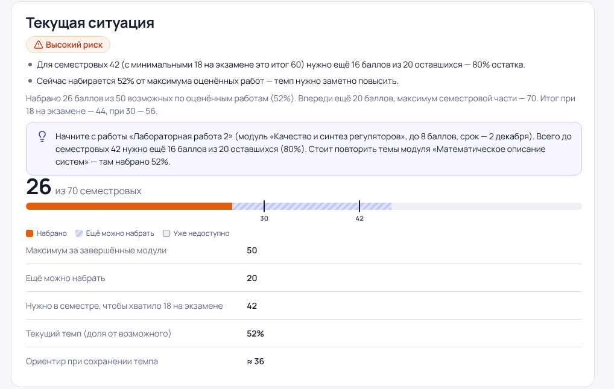 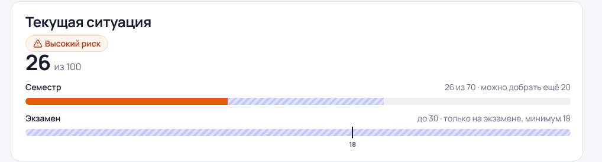 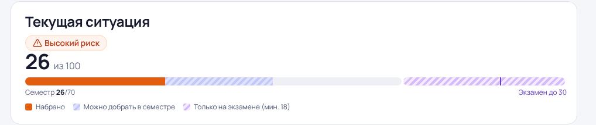 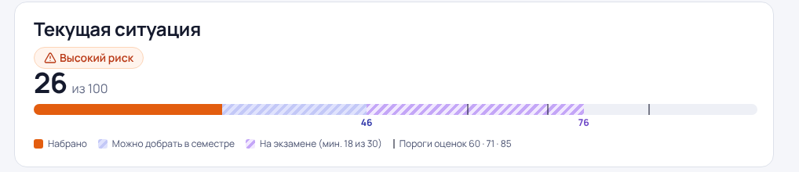

*Рис. 1. Эволюция шкалы (сверху вниз), кадры из истории git. **Версия 1** (до ручного теста, `8cbfa97`): много текста,
шкала только семестровых 70 баллов, таблица расчёта — информативно, но тяжело читать. **Версия 2** (`2ea1f3f`): тексты
убраны, но семестр и экзамен — **две отдельные шкалы** (автор: «нужно… на одной шкале»). **Версия 3** (`146ab17`):
одна шкала, но экзамен — **фиксированный участок 70–100**, хотя в семестре можно набрать только до 46; между ними
пустота. **Версия 4** (`e66a854`, итог): единая ось — набрано 26 → можно добрать в семестре до 46 → без разрыва
экзамен до 76; отметки оценок 60/71/85 и подписи потолков.*

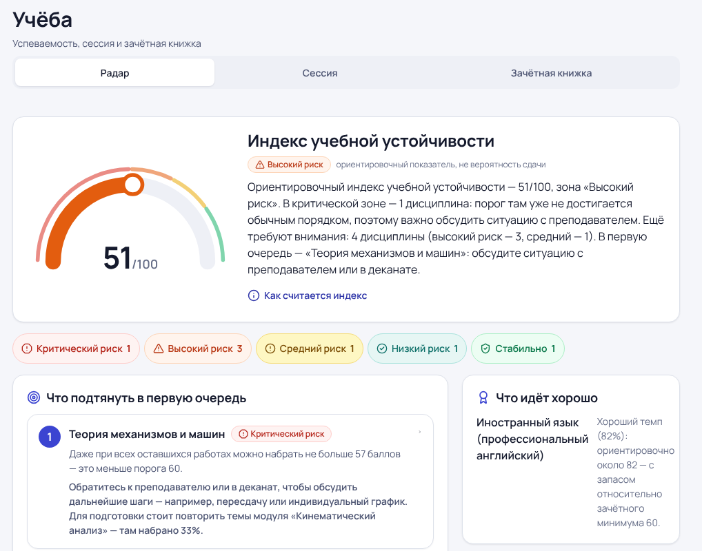 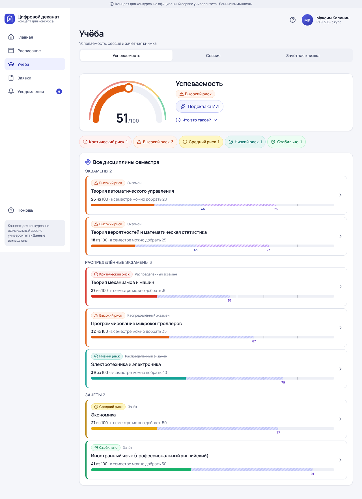

*Рис. 2. Вкладка «Учёба» до и после правок автора. Сверху — «Академический радар» первой версии: длинные пояснения,
блоки «Что подтянуть» с абзацами рекомендаций и «Что идёт хорошо». Снизу — «Успеваемость»: шкала 51/100 и зона,
кнопка «✨ Подсказка ИИ» (короткий вывод по запросу), «Что это такое?» (как считается число), фильтр по зонам и
дисциплины, сгруппированные по типу аттестации, у каждой — своя шкала.*

**Выводы.** Автоматические тесты не находят перегруженность и нелогичность — их находит человек. Две неудачные
попытки со шкалой закончились, когда автор разобрал её на числах одной дисциплины: конкретный пример снимает
неоднозначность лучше описания. После каждой итерации ИИ прогонял все 224 теста, 277 браузерных проверок и smoke,
поэтому правки интерфейса не сломали уже работающее.

---

## Метрики

| Показатель | Значение | Как получено |
|---|---|---|
| Промпты автора | 4 в ChatGPT (подготовка ТЗ) + стартовый промпт + 7 сообщений с правками | `ai-log/00a_…`, `07_user_feedback.md` |
| Документы для агентов | ТЗ v2 ≈ 62 тыс. знаков (20 разделов); 8 ролей ≈ 20 тыс. знаков; 6 промптов субагентам ≈ 35,7 тыс. знаков | `docs/source/`, `ai-log/` |
| Агентов | 7: координатор и 6 субагентов (роли 01, 03, 04, 05, 06, 07); роль 02 выполнял координатор | журнал |
| Коммиты | 12: с 21.11 22:15 по 22.11 | `git log` |
| Backend | Python 6 002 строки (домен аналитики 2 602), тесты 2 453, миграции 489 | `git ls-files … \| xargs wc -l` |
| Frontend | TSX 5 552, TS 1 651, CSS 3 872, e2e 775 строк | `git ls-files … \| xargs wc -l` |
| Данные сида | 4 JSON-файла, 4 804 строки: учебный план, демо-баллы, 142 материала, учебная структура | `backend/app/seed/data/` |
| Модель данных | 24 таблицы | `models.py`, миграция |
| Автотесты backend | **224** (148 домен + 26 API и сценарии + 50 QA), все проходят | `pytest -q` |
| Браузерные проверки | 277 (QA, 4 ширины) + smoke 25 экранов × 2 ширины | `frontend/e2e/` |
| Скриншоты | 46 итоговых + 87 QA | `docs/screenshots/` |
| Учебный план и материалы | 14 дисциплин, 63 темы; 142 проверенные ссылки, материалы у 63 тем из 63 | `curriculum.json`, `learning-resources.md` |
| Документация | 18 md-файлов в `docs/` (≈ 3 900 строк), 29 примеров ответов API, журнал из 15 этапов | `docs/` |
| Docker-образ | ≈ 300 МБ, процесс не от root | `docker images` |

---

## Скриншоты

Все скриншоты сняты автоматически скриптом `frontend/e2e/smoke.py` на чистой БД с демо-датой 23.11.2026. Мобильные —
ширина 360 px с плотностью 2×, десктопные — 1280 px. Полный набор — в [`screenshots/`](screenshots/). В PDF показаны
фрагменты.

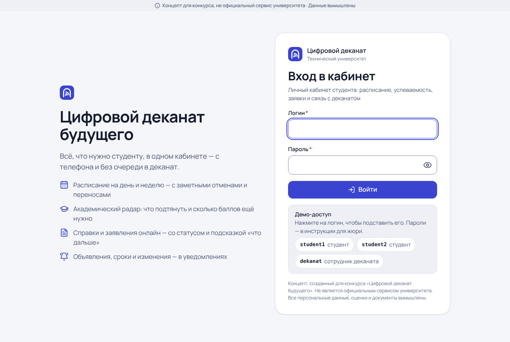

*Рис. 3. Вход (1280 px). Дисклеймер «Концепт для конкурса», собственный логотип, подсказка с демо-логинами без
паролей (пароли — в инструкции для жюри).*

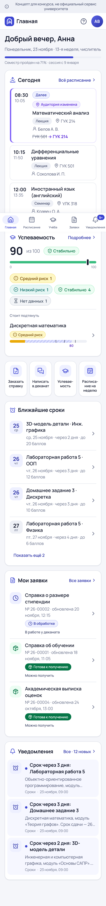 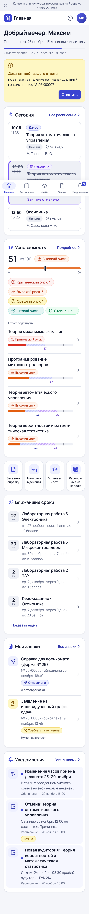

*Рис. 4. Главная на телефоне (360 px) у двух студентов — данные разделены. Слева Анна Воронцова: приветствие,
прогресс семестра, занятия сегодня с изменением аудитории. Справа Максим Калинин: баннер «Деканат ждёт вашего
ответа» по заявке и отменённое занятие. Нижняя панель навигации со счётчиком уведомлений.*

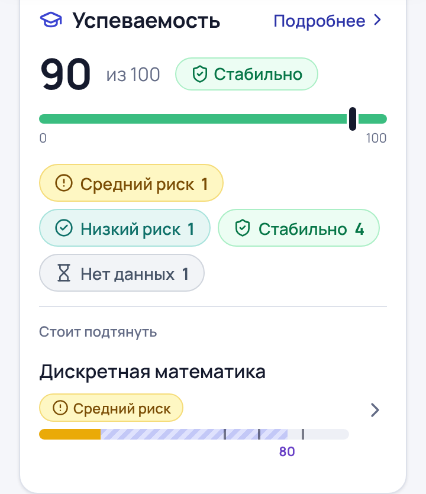 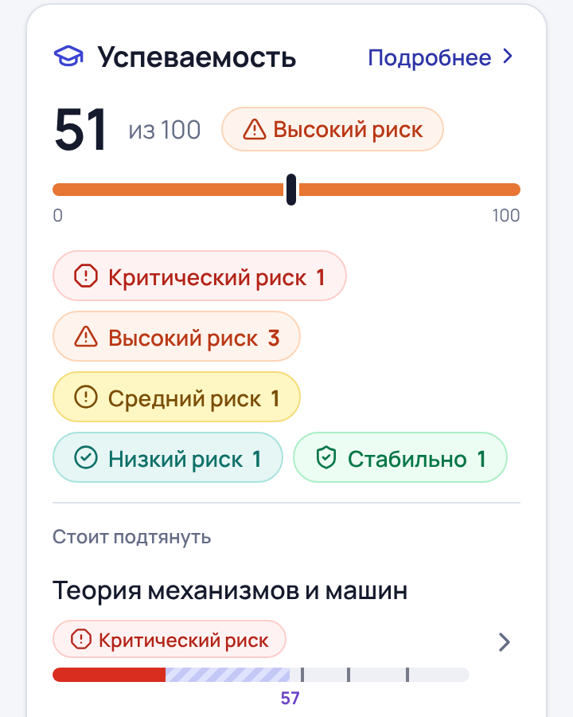

*Рис. 5. Блок «Успеваемость» на главной. Шкала целиком окрашена в цвет зоны (зелёная — 90 «Стабильно», оранжевая —
51 «Высокий риск»), подписаны только 0 и 100. Ниже — счётчики по зонам и «Стоит подтянуть»: предмет, риск и шкала
«семестр + экзамен» с отметками 60/71/85.*


*Рис. 6. Расписание, неделя 23–29 ноября: замена аудитории, отмена, перенос с указанием «откуда и куда», замена
преподавателя и дополнительное занятие. Каждое изменение выделено и цветом, и подписью.*


*Рис. 7. Дисциплина с экзаменом (ТАУ, student2). Сверху — единая шкала «семестр + экзамен»; ниже — достижимость
оценок 60/71/85 с планом «сколько добрать в семестре и сколько на экзамене», темы с пометкой «стоит повторить». Внизу
симулятор «Что если» с кнопками «Заполнить минимумом/максимумом»: результат — только итоговая оценка, ничего не
сохраняется.*

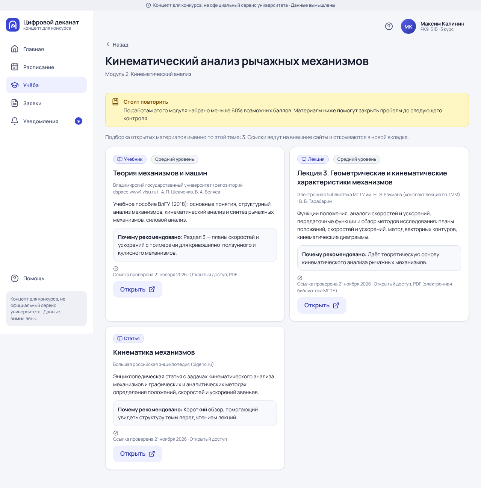

*Рис. 8. Тема «Кинематический анализ рычажных механизмов» (ТММ): проверенные материалы с типом, источником, кратким
содержанием, «Почему рекомендовано» и датой проверки ссылки (ТЗ §16.2).*

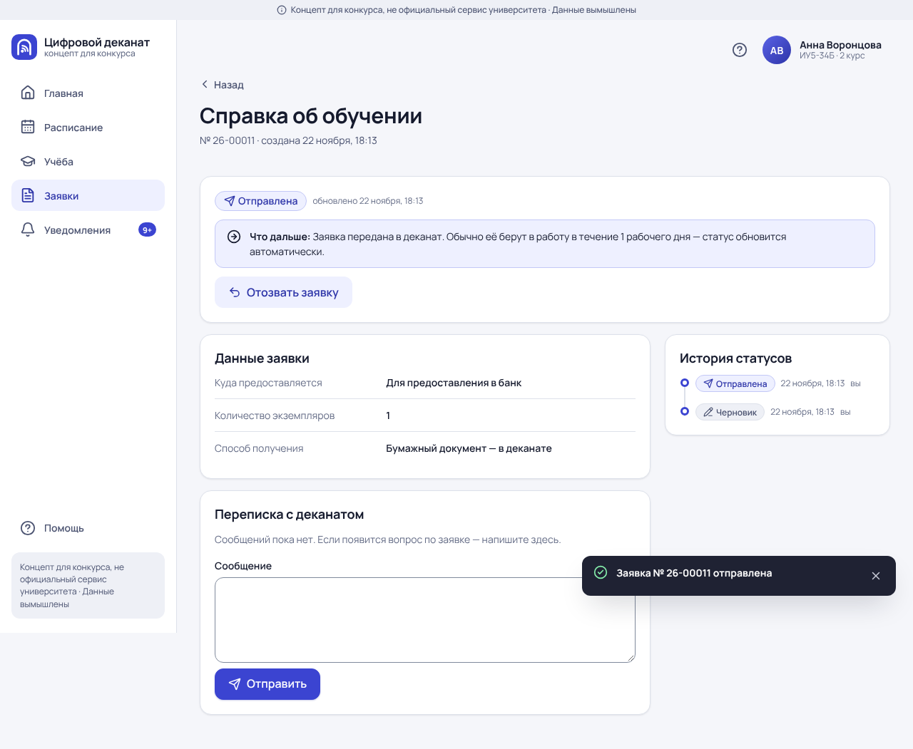

*Рис. 9. Заявка сразу после отправки: статус «Отправлена», блок «Что дальше», история статусов, переписка с деканатом.*


*Рис. 10. Кабинет сотрудника деканата: переходы статуса предлагаются только допустимые для текущего статуса.*

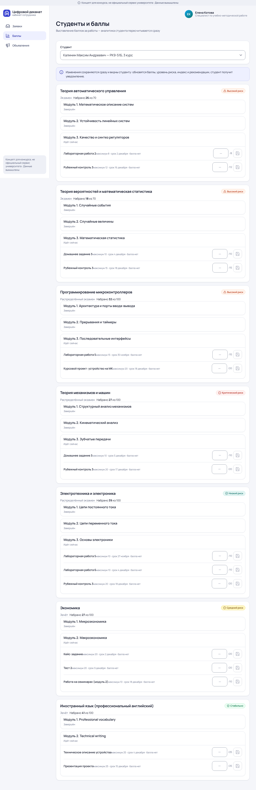

*Рис. 11. «Успеваемость студентов» в кабинете деканата после правки автора: выбор факультет → кафедра → группа →
студент, только просмотр баллов и рисков. Для пустой группы показывается «В группе пока нет студентов».*

---

## Ограничения процесса

- **Журнал — самоотчёт ИИ.** Хронологию вёл координатор; полной выгрузки диалога нет. Сообщения субагентам при
    возобновлении сохранены в пересказе, длинное сообщение автора с 8 замечаниями — тоже в пересказе. Числа и время в
    отчёте перепроверены по коду, git и меткам файлов.
- **Диалог с ChatGPT сохранён частично:** промпты автора — дословно, ответы ChatGPT — в виде итоговых файлов
    (ТЗ v2, роли, стартовый промпт), промежуточные версии (ТЗ v1) не сохранились.
- **Два агента из шести не прислали итоговых отчётов** (01 и 03, остановлены прерыванием). Результат принят по файлам.
- **Разделение ролей во frontend выдержано частично:** большую часть страниц написал координатор, который сам же их
    проверяет; это компенсируют e2e-обход, визуальная проверка, независимый QA и ручное тестирование автора.
- **Аналитика — экспертная эвристика.** Коэффициенты не обучались на реальных данных; это ориентир, а не вероятность,
    и так об этом сказано в интерфейсе.
- **Формальных опросов студентов не было** — гипотезы H1–H6 не проверены; удобство проверял автор на себе.
- **Работу прерывали внешние сбои:** около 4 часов простоя из-за лимита API, перезапуски песочницы останавливали
    фоновые процессы.

## Приложение А. Файлы журнала ИИ-разработки

| Файл | Что внутри |
|---|---|
| [`00a_chatgpt_spec_prompts.md`](ai-log/00a_chatgpt_spec_prompts.md) | 4 промпта автора в ChatGPT: от условий конкурса к ТЗ, ролям и стартовому промпту |
| [`00_initial_prompt.txt`](ai-log/00_initial_prompt.txt) | стартовый промпт автора координатору |
| [`process-log.md`](ai-log/process-log.md) | журнал координатора: этапы 0–14, решения, ошибки и исправления |
| [`01_agent04_analytics_prompt.md`](ai-log/01_agent04_analytics_prompt.md) / [`_report.md`](ai-log/01_agent04_analytics_report.md) | аналитика: промпт; отчёт и проверка координатором |
| [`02_agent05_resources_prompt.md`](ai-log/02_agent05_resources_prompt.md) / [`_report.md`](ai-log/02_agent05_resources_report.md) | материалы: промпт; отчёт и проверка |
| [`03_agent01_product_prompt.md`](ai-log/03_agent01_product_prompt.md) / [`_report.md`](ai-log/03_agent01_product_report.md) | продукт и UX: промпт; акт приёмки по файлам |
| [`04_agent03_frontend_prompt.md`](ai-log/04_agent03_frontend_prompt.md) / [`_report.md`](ai-log/04_agent03_frontend_report.md) | frontend: промпт; акт приёмки по файлам |
| [`05_agent06_qa_prompt.md`](ai-log/05_agent06_qa_prompt.md) / [`_report.md`](ai-log/05_agent06_qa_report.md) | задание независимому QA-агенту; итог |
| [`06_agent07_docs_prompt.md`](ai-log/06_agent07_docs_prompt.md) / [`_report.md`](ai-log/06_agent07_docs_report.md) | задание агенту-документатору; итог |
| [`07_user_feedback.md`](ai-log/07_user_feedback.md) | все правки автора по ходу разработки и разбор ошибок ИИ |
| [`source/`](source/) | ТЗ v2 и 8 ролей агентов, подготовленные автором в ChatGPT |
| `report-build/` | исходник PDF: `build_pdf.py`, фрагменты скриншотов (в том числе из истории git), шрифт Manrope (OFL) |
