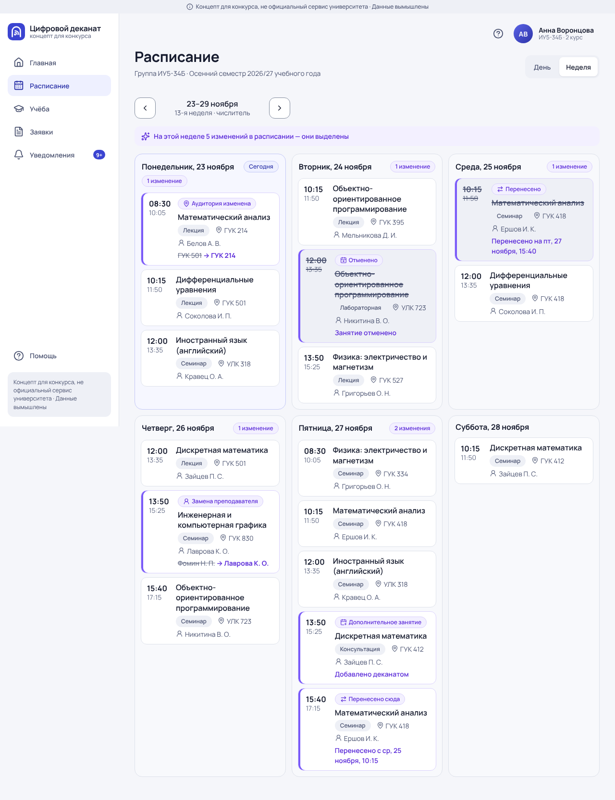
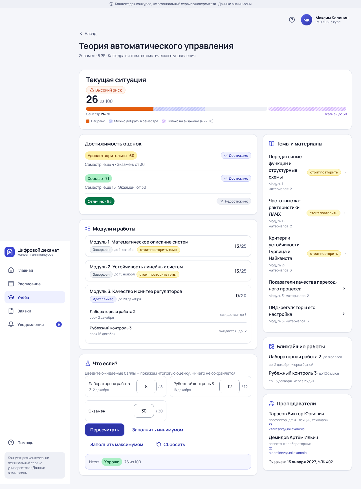
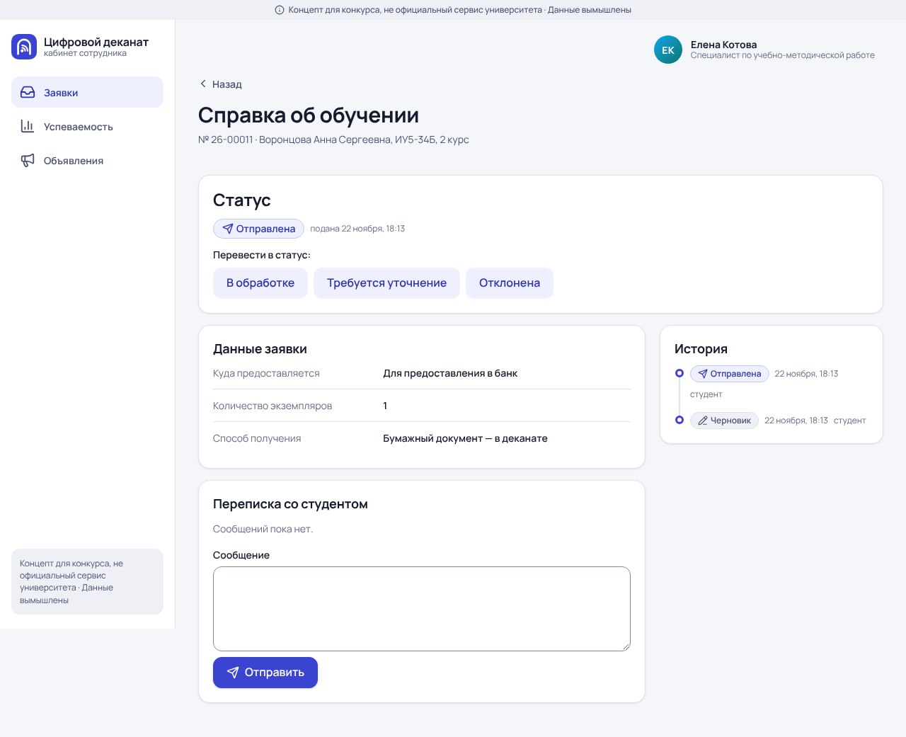
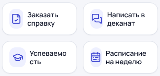
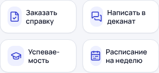

# Отчёт об использовании ИИ при создании прототипа «Цифровой деканат будущего»

> **Концепт, созданный для конкурса «Цифровой деканат будущего». Не является официальным сервисом университета.**
> Все ФИО, группы, оценки и обращения в прототипе вымышлены.

**Что это за документ.** Описание того, как прототип личного кабинета студента создавался с помощью ИИ: какие
инструменты и агенты работали, какими промптами ставились задачи, как проверялись результаты, какие ошибки допустил ИИ
и как их нашли и исправили. Документ подготовил агент-документатор (роль 07) 22.11.2026. Опирается он только на
артефакты, которые можно проверить: журнал координатора [`ai-log/process-log.md`](ai-log/process-log.md), промпты и
отчёты субагентов в [`ai-log/`](ai-log/), историю git, документы в `docs/`, код и скриншоты. Если какого-то
артефакта нет, это сказано прямо. PDF-версия этого отчёта: [`ai_development_report.pdf`](ai_development_report.pdf).

## Коротко

- **Инструмент:** Claude Code с моделью Claude Opus 5.5 в режиме агента с субагентами. Всё работало в облачной
    Linux-песочнице: Python 3.13, Node 22, Docker, Playwright и Chrome.
- **Организация:** **7 агентов**. Координатор вёл проект и сам написал backend (роли 00 и 02), остальные шесть
    субагентов получили роли 01, 03, 04, 05, 06 и 07 из архива `agent_roles/`. Сначала координатор зафиксировал контракты
    между частями системы, затем агенты работали параллельно, и у каждого была своя зона файлов.
- **Сохранено:** стартовый промпт, 6 полных промптов субагентам (около 35,7 тыс. знаков), журнал из 8 этапов и
    акты приёмки результатов 4 агентов.
- **Проверки:** **173 автотеста** backend (148 тестов домена аналитики и 25 тестов API, безопасности и сценариев) все
    проходят. E2E-обход Playwright: 24 экрана на ширинах 360 и 1280 px, три роли. Аналитика сверена с эталоном,
    посчитанным вручную. Docker-образ собран и проверен. Независимый QA-агент ещё работает, его результаты см. в
    разделе 11.3.6.
- **Ошибки ИИ найдены и исправлены:**
    - 2 дефекта в backend нашла самопроверка;
    - выдуманные данные в продуктовом документе нашла сверка фактов;
    - гонку, из-за которой сервер отвечал HTTP 500, нашёл e2e-тест;
    - 5 визуальных дефектов нашёл просмотр скриншотов;
    - при подготовке отчёта найдено ещё одно критичное замечание: демо-данные не попадают в git (см. 11.3.9).

## Как устроен документ

Основные разделы пронумерованы 11.1–11.3: так их назвал координатор в постановке для документатора. В ТЗ
обязательное содержание описания процесса перечислено в §10.3, а критерий жюри «Масштаб использования
нейротехнологий» — это §11.2. Ниже показано, где что искать.

| Раздел отчёта | ТЗ §10.3 (обязательное содержание) | Что оценивает критерий ТЗ §11.2 |
|---|---|---|
| 1. Проблема и продуктовая идея | п. 1 «Проблема и продуктовая идея» | осмысленность применения ИИ |
| 11.1 Подход | п. 2 «Инструменты», п. 6 «Ручная работа» | широта применения, продуманность процесса |
| 11.2 Промпты и диалоги | п. 3 «Промпты и диалоги» | качество постановки задач, промптов, контекстных документов |
| 11.3 Процесс | п. 4 «Ход разработки», п. 5 «Архитектура и безопасность» | работа с ошибками и ограничениями ИИ |
| Скриншоты | п. 4 (скриншоты) | наглядность описания |
| Ограничения процесса | — | честность описания |

**Содержание:** 1. Проблема и продуктовая идея · 11.1 Подход · 11.2 Промпты и диалоги · 11.3 Процесс · Метрики ·
Скриншоты · Ограничения процесса · Что нужно получить у команды · Приложение А. Файлы журнала.

---

## 1. Проблема и продуктовая идея

**Проблема (ТЗ §1).** Учебная информация и административные процессы разбросаны по сайтам, чатам, почте и очным
визитам в деканат. Агент 01 в [`product-decisions.md`](product-decisions.md) уточнил эту проблему. Студент должен за
минуту и с телефона ответить себе на четыре вопроса:
1. что у меня сегодня и не изменилось ли что-то;
2. всё ли в порядке с учёбой и что сделать первым;
3. сколько ещё нужно набрать;
4. где мой документ.

Каждый раздел кабинета отвечает на вопрос «что мне делать дальше».

**Почему выбраны именно эти разделы.** Обязательное ядро ТЗ: вход и профиль, главная, расписание с изменениями,
успеваемость, заявки, уведомления. К нему добавлены три вещи:
- **«Академический радар».** Это индекс учебной устойчивости, уровни риска по дисциплинам, нужные баллы и симулятор
    «Что если» (ТЗ §15).
- **Подбор проверенных материалов** по слабым темам (ТЗ §16).
- **Минимальный кабинет сотрудника деканата.** Без него жюри не увидит, как меняется статус заявки и как
    пересчитывается аналитика.

Решения D-01…D-17 с отклонёнными альтернативами описаны в `product-decisions.md`, раздел 5.

**Основные сценарии.** В [`user-journeys.md`](user-journeys.md) описано 10 сценариев (С1–С10): вход и смена аккаунта,
утро студента, расписание, путь «индекс → дисциплина → модуль → тема → материалы», «сколько баллов нужно» и «что
если», заказ справки, ответ на уточнение, уведомления, работа сотрудника, мобильный сценарий на 360 px.

**Исследование потребностей.** Опросов и интервью студентов в рамках проекта **не проводилось**. ИИ-агенту прямо
запретили их выдумывать: «Не придумывай опросы студентов и их результаты — если упоминаешь исследования, помечай как
гипотезы для проверки» (промпт агента 01). Поэтому в `product-decisions.md`, раздел 2, есть только гипотезы H1–H6 с
методикой проверки и критериями подтверждения. Если команда проведёт опросы, их результаты нужно добавить сюда.

---

## 11.1 Подход

### 11.1.1 Инструменты ИИ и среда

| Инструмент | Для чего использовался | Кто использовал |
|---|---|---|
| **Claude Code**, модель **Claude Opus 5.5**, режим агента | Анализ ТЗ, планирование, весь код, тесты, документация, проверка результатов | координатор и все субагенты |
| Субагенты (фоновые агенты с отдельным промптом) | Параллельная работа специализированных ролей с изолированными зонами файлов | координатор |
| WebSearch / WebFetch | Поиск учебных материалов и проверка каждой ссылки: открывается ли страница и соответствует ли теме | агент 05 |
| Bash в облачной Linux-песочнице | Запуск Python 3.13 (venv), Node 22 и npm, git, Docker | все |
| pytest; `tsc --noEmit`; `npm run build` | Автотесты backend и аналитики; проверка типов и сборки frontend | координатор, агенты 04, 03 |
| Playwright (Python) + Google Chrome | E2E-обход экранов на 360 и 1280 px, проверка консоли и горизонтальной прокрутки, скриншоты, печать этого отчёта в PDF | координатор, агенты 03, 06, 07 |
| Просмотр изображений (инструмент Read) | Визуальная проверка скриншотов: ИИ смотрит на экран так же, как человек | координатор, агенты 03, 07 |
| Docker / BuildKit | Сборка и проверка production-образа | координатор |

**IDE и редакторы.** Код писали агенты прямо в файловой системе песочницы, IDE в процессе не использовалась.
**Отдельные сервисы для дизайна, текстов и изображений** в журнале не упоминаются. Дизайн-систему, собственный
SVG-логотип и все тексты интерфейса создали те же агенты в коде
([`design-system.md`](design-system.md), `frontend/src/components/ui/Logo.tsx`). Если команда что-то делала в других
инструментах вне этой сессии, это нужно добавить отдельно.

### 11.1.2 Агенты, роли и зоны ответственности

| Агент | Роль (`agent_roles/`) | Зона файлов (менять можно только их) | Результат |
|---|---|---|---|
| **Координатор** | 00 координатор + 02 архитектор/backend | backend, кроме домена аналитики; сид; `curriculum.json`, `demo_results.json`; контракты; архитектурная документация; Docker | 24 таблицы и миграция Alembic; сессии, CSRF, argon2id, лимит входа; API студента, заявок, уведомлений и деканата; 25 API-тестов; 29 реальных ответов API в `api-examples/`; Docker, деплой. После остановки агента 03 дописал 15 страниц frontend, `e2e/smoke.py` и `design-system.md` |
| Агент 04 | Аналитика | `backend/app/domain/analytics/**`, `backend/tests/domain/**`, `analytics-model.md` | Детерминированный модуль: три типа аттестации, риск, цели, индекс, приоритеты, тексты; **148 тестов**; демо-индексы 90 и 51 совпали с эталоном |
| Агент 05 | Материалы | `learning_resources.json`, `learning-resources.md` | **142 проверенные ссылки**, материалы есть у 63 тем из 63; минимум 2 материала у каждой темы |
| Агент 01 | Продукт и UX | 5 документов: `user-journeys`, `information-architecture`, `product-decisions`, `analytics-ux`, `ux-brief` | ≈ 2 000 строк продуктовых документов: сценарии, карта маршрутов, решения, подача аналитики, бриф с микрокопирайтингом |
| Агент 03 | Frontend и UX/UI | `frontend/**`, `design-system.md`, `screenshots/**` | Инфраструктура SPA (API-клиент с CSRF, 40 хуков TanStack Query, типы по реальным ответам API), каркас, 14 UI- и 5 доменных компонентов, ≈ 3 800 строк CSS, экраны «Вход», «Главная», «Расписание» |
| Агент 06 | QA и безопасность (независимо) | `test_qa_security.py`, `e2e/qa_scenarios.py`, `test-report.md`, `screenshots/qa/` | работает, см. 11.3.6 |
| Агент 07 | Документатор | этот отчёт и PDF, `report-build/`, `README.md`, `jury-instructions.md` | этот документ |

Источники таблицы: [`process-log.md`](ai-log/process-log.md), этап 2, и отчёты `ai-log/0N_*_report.md`.

### 11.1.3 Схема работы

```
Пользователь ── ТЗ v2 · архив agent_roles/ · стартовый промпт
     │
     ▼
Координатор (роли 00 + 02) ── контракты до запуска агентов:
     │   analytics-contract.md · curriculum.json · demo_results.json (с эталонными ответами)
     │   api-contract.md · api-examples/*.json (снятые с работающего сервера)
     ├─► Агент 04  Аналитика ........ domain/analytics + 148 тестов
     ├─► Агент 05  Материалы ........ 142 проверенные ссылки (WebSearch / WebFetch)
     ├─► Агент 01  Продукт и UX ..... 5 продуктовых документов
     ├─► Агент 03  Frontend ......... инфраструктура SPA, дизайн-система, 3 экрана
     ├─► Агент 06  QA (независимо) .. test-report.md
     └─► Агент 07  Документация ..... этот отчёт
     ▲
     └── приёмка: независимый прогон pytest · сверка с эталоном · скрипты проверки данных ·
         tsc · Playwright (360/1280 px) · просмотр скриншотов · сверка фактов с сидом
```

### 11.1.4 Порядок постановки задач

1. **Анализ.** Координатор целиком изучил ТЗ, 8 ролей и стартовый промпт. Затем он определил ограничение среды: из
    песочницы нельзя опубликовать сайт. Решение: подготовить готовый Docker-образ и инструкцию деплоя, а публикацию
    выполнит команда. Вопрос задан пользователю, работа не блокировалась.
2. **Контракты до параллельной работы** (этап 1). Учебный план `curriculum.json` содержит 14 дисциплин и 63 темы.
    Скрипт проверил, что суммы максимумов работ совпадают с максимумом семестра. Контракт аналитики и демо-баллы
    составлены с **заранее посчитанными вручную** ожидаемыми уровнями риска и индексами. Так у агентов, работающих
    параллельно, появилась общая «истина», и её можно проверить.
3. **Параллельный запуск.** Агенты 04, 05 и 01 запущены в 22:01–22:03, судя по меткам файлов промптов. Frontend-агент
    запущен в 22:16, после коммита backend. К этому моменту реальные ответы API уже были сняты в `api-examples/`, и типы
    TypeScript писались по ним, а не по догадкам.
4. **Правило зон.** Каждый агент менял только свои файлы. Об этом прямо сказано в каждом промпте: «Изменяй ТОЛЬКО…».
    Это требование ТЗ §7 п. 5: не давать нескольким агентам бесконтрольно менять одни и те же файлы.
5. **Независимая проверка в конце.** QA-агент получил роль «строгого члена жюри и атакующего» и запрет исправлять код
    продукта. Найденные дефекты исправляет координатор, а тесты, которые падают на этих дефектах, остаются как проверка
    исправлений.

### 11.1.5 Как проверялись и интегрировались результаты

Координатор не принимал ни один результат ИИ на слово. Для каждого агента была своя проверка:

| Результат | Как проверен координатором |
|---|---|
| Аналитика (агент 04) | Независимый прогон всего набора: `pytest -q` дал **172 passed**. Уровни риска и индексы вручную сверены с эталоном в `demo_results.json`. Каждое отклонение от контракта проверено по ТЗ §14.2 |
| Материалы (агент 05) | Скрипт проверил, что JSON валиден, записей 142, темы есть у 63 из 63, все `topic_keys` существуют, `id` уникальны. Интеграционно проверено, что `sync_resources()` загрузил каталог, а API отдаёт подборки по слабым темам |
| Продуктовые документы (агент 01) | Сверка фактов с сидом нашла расхождение в таблице изменений расписания, оно исправлено. Расчёт индексов агентом совпал с контрактом |
| Frontend (агент 03 + координатор) | Проверены `tsc --noEmit` и `npm run build`. Playwright-обход 24 экранов на двух ширинах проверил горизонтальную прокрутку и ошибки консоли. Скриншоты просмотрены, исправлено 5 визуальных дефектов |
| Backend (координатор) | Самопроверка кода до тестов нашла 2 дефекта. 24 теста, позже 25. Аналитика через API сверена с эталоном. Ответы API сняты с работающего сервера |
| Docker | Полная сборка, затем проверка контейнера: `/api/health`, раздача SPA по вложенным маршрутам, `/api/docs` закрыт в production, процесс работает не от root (UID 10001), **заявка сохраняется после `docker restart`** |

### 11.1.6 Участие человека и ручная работа

По журналу и стартовому промпту роли распределились так:

| Решал или делал человек (пользователь, команда) | Решал или делал ИИ |
|---|---|
| Подготовил ТЗ v2, архив ролей и стартовый промпт, то есть цель, правила работы и приоритеты | Стек, архитектуру, модель данных, контракты, распределение ролей, демо-данные, все допущения A1–A15 (`assumptions.md`) |
| Получил вопрос о публикации. Ответ в журнале не зафиксирован, публикация остаётся за командой | Код backend и frontend, тесты, Docker, документацию, отбор учебных материалов |
| Заметил, что Docker-демон остановился, и указал на это координатору (этап 6) | Приёмку результатов агентов и решения принять или отклонить их отклонения от контракта |
| Прервал ожидающую команду, из-за чего остановились агенты 01 и 03 (этап 7) | Решение **не перезапускать** агента без явной команды пользователя и дописать экраны самому |
| Опубликует приложение, проверит вход на публичной версии и доступность из РФ, передаст материалы жюри | Подготовку инструкций: `deploy.md`, `jury-instructions.md` |

**Что не делегировано ИИ полностью:**
- публикация и проверка опубликованной версии;
- решение о перезапуске остановленных агентов, которое оставлено за пользователем;
- проверка гипотез о потребностях студентов на реальных людях.

Других ручных правок кода человеком журнал не фиксирует. Если они были, их нужно добавить.

---

## 11.2 Промпты и диалоги

Полные тексты лежат в [`docs/ai-log/`](ai-log/). Ниже приведены короткие точные цитаты, которые показывают, *как*
ставилась задача.

### 11.2.1 Стартовый промпт (пользователь → координатор)

Файл [`00_initial_prompt.txt`](ai-log/00_initial_prompt.txt), около 2,2 тыс. знаков. Ключевые фрагменты:

> «Используй инструкции из agent_roles/ для распределения задач между специализированными агентами.»
> «Если среда поддерживает субагентов, задействуй их.»
> «Не ограничивайся планированием и генерацией отдельных фрагментов кода. Твоя конечная задача — довести проект до
> рабочего, протестированного и опубликованного веб-прототипа.»
> «Главный приоритет — соответствие основному ТЗ и качество конечного работающего приложения.»

Промпт требует сначала коротко представить понимание задачи, план, стек и критические вопросы, а затем сразу
переходить к реализации.

### 11.2.2 Как устроены промпты субагентам

Все 6 промптов построены по одному шаблону. Каждый раздел шаблона закрывает конкретный риск работы с ИИ:

| Раздел промпта | Зачем |
|---|---|
| Роль и место в команде («Координатор — главный агент; он интегрирует твой модуль») | агент понимает границы своей ответственности |
| **Контекст с путями к файлам**: разделы ТЗ, файл роли, контракты, реальные данные | агент опирается на документы, а не на догадки (ТЗ §7 п. 3–4) |
| **Решения координатора, которые нельзя менять** | агенты не принимают противоречивых решений |
| Задача с проверяемыми критериями (числа, имена тестов, пороги) | результат можно принять или отклонить объективно |
| **Правила: «Изменяй ТОЛЬКО …»**, запрет выдумывать, лицензии | агенты не перезаписывают файлы друг друга, нет фиктивного контента |
| **Обязательная самопроверка до отчёта** (pytest, валидация JSON, Playwright) | агент сдаёт проверенный результат |
| **Формат отчёта**: файлы, решения, *отклонения от контракта*, ограничения | отклонения становятся видимыми, а не скрытыми |

| Файл промпта | Агент и задача | Этап | Объём |
|---|---|---|---|
| [`01_agent04_analytics_prompt.md`](ai-log/01_agent04_analytics_prompt.md) | 04: модуль аналитики | 2 (22:01) | 4,3 тыс. знаков |
| [`02_agent05_resources_prompt.md`](ai-log/02_agent05_resources_prompt.md) | 05: каталог материалов | 2 (22:02) | 4,8 тыс. |
| [`03_agent01_product_prompt.md`](ai-log/03_agent01_product_prompt.md) | 01: продуктовые документы | 2 (22:02) | 6,2 тыс. |
| [`04_agent03_frontend_prompt.md`](ai-log/04_agent03_frontend_prompt.md) | 03: интерфейс | 2 (22:16) | 11,9 тыс. |
| [`05_agent06_qa_prompt.md`](ai-log/05_agent06_qa_prompt.md) | 06: независимое тестирование | 8 (запуск ~03:20) | 4,9 тыс. |
| [`06_agent07_docs_prompt.md`](ai-log/06_agent07_docs_prompt.md) | 07: документация процесса | 8 (запуск ~03:21) | 3,6 тыс. |

### 11.2.3 Архитектура и контракты

Отдельного агента-архитектора не было: роль 02 выполнял координатор. Архитектурные решения переданы агентам в виде
**контрактов**, и эти контракты фактически стали частью их промптов:
- [`analytics-contract.md`](analytics-contract.md): входные и выходные структуры, порядок классификации риска,
    формулы индекса и приоритетов;
- [`api-contract.md`](api-contract.md) и [`api-examples/`](api-examples/): 29 реальных ответов сервера, которые
    служат эталоном структур для frontend;
- [`architecture.md`](architecture.md), [`data-model.md`](data-model.md), [`security.md`](security.md),
    [`assumptions.md`](assumptions.md): решения и обоснования стека.

Фрагмент промпта frontend-агента: «**API:** `docs/api-contract.md` + реальные ответы сервера в
`docs/api-examples/*.json` (это эталон структур — по ним пиши TypeScript-типы)».

### 11.2.4 Аналитика (агент 04)

> «Реализуй пакет `backend/app/domain/analytics/` — чистый, детерминированный, объяснимый модуль (без БД, FastAPI, ORM,
> сети, случайности, без чтения текущей даты внутри — дата приходит во входе)»
> «Если найдёшь противоречие с ТЗ — приоритет у ТЗ: исправь и явно опиши отклонение в отчёте.»
> «Если твой алгоритм по контракту даёт другой результат — НЕ подгоняй данные молча: сначала перепроверь расчёт
> вручную; если расхождение в контракте или данных — опиши его в отчёте с числами.»

Промпт перечисляет граничные тесты поимённо: 59/60 для зачёта, 60/71/85 при разном остатке, «экзамен сдан на 17 →
critical, на 18 → допускается», «одна критическая дисциплина при 6 зелёных → индекс ≤ 59» и другие. Он также требует
сценарный тест на демо-данных с заранее известным ответом.

### 11.2.5 Подбор материалов (агент 05)

> «подбирай материалы **по конкретной теме**, а не по названию дисциплины»
> «Каждый URL открой через WebFetch и убедись, что страница существует и действительно про эту тему. Только тогда
> `verified`.»
> «Не выдумывай названия, авторов, ссылки, длительность и содержание. Автор — только если он виден на странице.»
> «Пустая подборка лучше фиктивной.»

Отдельное требование: сайты должны открываться из России без VPN. Сервисы, которые в РФ заблокированы или сильно
замедлены, по возможности не использовать.

### 11.2.6 Продукт и UX (агент 01)

> «Решения координатора (зафиксированы, не меняй — развивай и обосновывай)»
> «Разделы и функции (только эти; новых не добавляй)»
> «Не придумывай опросы студентов и их результаты — если упоминаешь исследования, помечай как гипотезы для проверки.»

Промпт фиксирует персоны трёх демо-аккаунтов, навигацию (нижняя панель из 5 пунктов) и полный список разделов.
Это защищает от «расползания» продукта.

### 11.2.7 Интерфейс (агент 03)

> «паролей в клиентском коде быть не должно»
> «Никаких кнопок «в никуда», заглушек, `console.log`, ошибок в консоли браузера.»
> «**Backend не трогай.** Если найдёшь ошибку или нехватку данных в API — не обходи молча: опиши в отчёте»
> «Автоматически проверь: нет горизонтального скролла (`document.documentElement.scrollWidth <= innerWidth`) на всех
> основных страницах при 360 px; нет ошибок в консоли»

Промпт задаёт точные маршруты (ссылки в уведомлениях backend уже их используют), состав каждого экрана, обязательные
состояния (loading, empty, error, success, validation, disabled) и набор компонентов дизайн-системы. Он требует
пройти сценарии ТЗ §8.1 в Playwright и просмотреть скриншоты.

### 11.2.8 Тестирование (агент 06)

> «Ты **не участвовал в разработке** и проверяешь продукт независимо — как строгий член жюри и как атакующий. Цель —
> найти дефекты до сдачи, а не подтвердить, что всё хорошо.»
> «Заявления документации — это гипотезы, которые ты проверяешь, а не факты.»
> «Тесты, которые сейчас падают из-за найденных дефектов, оставь падающими и пометь в отчёте — по ним координатор
> проверит исправления.»

Промпт перечисляет атаки: IDOR по всем ресурсам с ID, старая cookie после выхода, CSRF (без токена, с чужим токеном,
form-urlencoded), повышение привилегий, XSS, open redirect через `next`, path traversal, секреты в собранном JS. Он
также требует вручную пересчитать по одной дисциплине каждого типа аттестации.

### 11.2.9 Документация (агент 07)

> «Фактические источники (используй только их, ничего не выдумывай)»
> «Не приписывай ИИ того, чего не было в журнале, не скрывай ошибки.»

### 11.2.10 Итерации доработки: сообщения агентам после проверок

| Когда | Кому | Повод | Содержание сообщения | Итог |
|---|---|---|---|---|
| 21.11, после приёма аналитики | агенту 03 | Агент 04 предупредил, что `current_grade` для распределённого экзамена считается по текущей сумме | Не показывать это значение как оценку до конца семестра, подписывать «по текущим баллам» | в интерфейсе оценка выводится только по завершении семестра («Оценка по итогам семестра», `DisciplinePage.tsx`) |
| 22.11, после сброса лимита API | агентам 01, 03, 05 | Все трое остановились по лимиту посреди работы | Координатор проверил полноту файлов скриптом и **возобновил тех же агентов с их контекстом**, передав, что уже сделано и что осталось | агент 05 дописал документ, не перезаписав готовый каталог; агенты 01 и 03 продолжили работу |
| 22.11, после сверки фактов | агенту 01 | Таблица изменений расписания в `user-journeys.md` не совпадала с сидом: даты и предметы были выдуманы | Исправление с эталонными данными | при повторной проверке все 14 изменений совпали с `SCHEDULE_CHANGES` |
| 22.11, ~03:00 | агенту 03 | Агент остановился, когда пользователь прервал команду | Без команды пользователя агент не перезапускался, координатор дописал экраны сам | см. 11.3.4, п. 8 |
| после отчёта QA | координатору | дефекты QA | будет дополнено координатором | — |

**Ограничение.** Точные тексты этих сообщений в `docs/ai-log/` не сохранены, есть только их пересказ в журнале
координатора. Полные промпты сохранены дословно.

---

## 11.3 Процесс

### 11.3.1 Ключевые этапы и время

Время указано по Москве. В колонке «по журналу» стоят отметки координатора, в колонке «по меткам» — объективное время
коммитов git, изменения файлов и создания Docker-образа.

| Этап | По журналу | По меткам git и файлов | Что сделано |
|---|---|---|---|
| 0. Анализ | 21.11 ~21:50 | стартовый промпт 21:54 | изучены ТЗ и роли, план, вопрос о публикации |
| 1. Контракты | — | `demo_results.json` 22:01 | учебный план, контракт аналитики, демо-баллы с эталоном |
| 2. Запуск агентов | — | промпты 04, 05, 01: 22:01–22:03; промпт 03: 22:16 | 4 субагента в фоне |
| 3. Backend | — | коммит `11c690d` 21.11 22:15 | модели, авторизация, API, сид, тесты безопасности |
| 4. Инфраструктура | — | Docker-файлы 22:17 | Dockerfile, compose, Caddy, Amvera, `deploy.md` |
| 5. Приём и сбой | 21.11 ~22:30 → 22.11 02:50 | отчёт агента 04 в 22:25; каталог в 22:29; коммит `e742e0b` 22.11 02:51 | приём аналитики (172 теста); остановка трёх агентов по лимиту API; возобновление |
| 6. Docker-сборка | 22.11 ~03:00 | `Dockerfile` 03:01 | обход сетевых ограничений песочницы (секрет `extra_ca`) |
| 7. Интерфейс | 22.11 03:00–03:40 | скриншоты 03:17; коммит `8b3143c` 03:18 | 15 страниц, e2e, исправление HTTP 500, визуальные правки |
| 8. Образ и QA | 22.11 ~03:45 | образ `deanate:test` 03:18:52; коммит `014b97d` 03:20 | образ 300 МБ проверен; запущен QA-агент |
| 9. Документация | — | с ~03:21 | этот отчёт |

Активная работа шла двумя отрезками: примерно 21:50–22:30 и 02:50–03:20. Между ними был простой: лимит запросов API,
затем перезапуск песочницы. Время этапов 7–8 в журнале (03:40 и 03:45) **не совпадает** с метками файлов: работа
закончилась к 03:19. Это неточность журнала. Достоверными следует считать метки git и файлов.

### 11.3.2 Как создавалась аналитика (ТЗ §14–§18)

1. **Формализация трёх типов аттестации.** Координатор описал их в контракте, агент 04 реализовал в `config.py`:
    - A: зачёт, 0–100, порог 60;
    - B: распределённый экзамен, 0–100, цели 60/71/85;
    - C: экзамен, семестр 0–70 плюс экзамен 18–30, **минимум 18 обязателен**.
2. **Неоднозначность порога 60.** В исходной шкале границы пересекаются («0–60 неуд», «60–70 удовл»). Принято правило
    ТЗ §14.1: 60 — уже «удовлетворительно». Граница вынесена в `DEFAULT_GRADE_BANDS`, поэтому другую трактовку можно
    задать конфигурацией (тест `test_custom_grade_bands_change_targets`, допущение A1).
3. **Формулы достижимости.** Целевой семестровый уровень S равен 60 для типов A и B и 60 − 18 = 42 для типа C. Граница
    невозможности F для типа C равна 60 − 30 = 30. Дефицит D = max(0, S − текущее), требуемая доля остатка r = D / остаток.
4. **Классификация риска.** Упорядоченные правила, срабатывает первое (таблица в `analytics-model.md`, раздел 5).
    - «Недостаточно данных», если пропущено больше 50 % баллов завершённых модулей.
    - Ветки экзамена: сдан ниже 18 → critical.
    - «Недостижимо» → critical.
    - Пороги r ≥ 0,9 и r ≥ 0,7 и разрыв с темпом.
    - Пока оценено меньше 25 % максимума, темп считается ненадёжным, поэтому ранний низкий балл не даёт critical
     (ТЗ §18 п. 6).
5. **Сводный индекс.** Баллы уровней: stable 100, low 80, medium 60, high 35, critical 10. Индекс — их среднее с
    ограничениями сверху: при наличии critical не выше 59, при наличии high не выше 74. Без ограничения 6 стабильных
    дисциплин и 1 критическая дали бы 87 и зелёную зону, с ограничением получается **59**. Индекс везде подписан как
    «ориентировочный», слова «вероятность» и «шанс» в текстах запрещены и проверяются тестом.
6. **Граничные тесты.** Все 12 случаев ТЗ §18 оформлены отдельными тестами с понятными именами (таблица в
    `analytics-model.md`, раздел 15). Отдельно проверены границы 59/60, 41/42, экзамен 17/18, need 30/31 и другие.
    Всего 148 тестов.
7. **Проверка против эталона.** Ожидаемые результаты координатор посчитал вручную *до* написания модуля:
    - student1: 4 дисциплины stable, 1 low, 1 medium, 1 insufficient_data, индекс 90;
    - student2: 1 critical, 3 high, 1 medium, 1 low, 1 stable, среднее 50,7, индекс **51**.

    Агент 04 получил запрет подгонять данные. Все 14 уровней и оба индекса совпали «без подгонки». Независимый расчёт
    продуктового агента дал те же 90 и 51.
8. **Отклонения от контракта.** Агент заявил их сам, координатор проверил по ТЗ:
    - цели типа C до сдачи экзамена получают статус `achievable`, а не `reached`, потому что по ТЗ оценки нет, пока
     экзамен не сдан на ≥ 18;
    - если этап семестра неизвестен, ориентир по темпу не строится;
    - если сумма максимумов работ не совпадает с максимумом семестра, это запись в `data_issues`, а не исключение;
    - `min_evidence_share` = 0,25.

    Все отклонения приняты (`01_agent04_analytics_report.md`).

### 11.3.3 Как подбирались учебные материалы (ТЗ §16)

- **Источник тем.** Темы взяты из учебного плана прототипа: 14 дисциплин, 63 темы. Поиск шёл по формулировке
    конкретной темы. Например, для темы о тройных интегралах отдельно искали материал по сферическим координатам, потому
    что основной урок покрывал только цилиндрические.
- **Механизм.** Кандидатов искали через WebSearch по теме и по оглавлениям открытых ресурсов: МатПрофи, METANIT,
    OpenStax, All About Circuits и других. **Каждый URL открывался через WebFetch.** Для PDF сверялись титульный лист и
    нужные разделы. В каталог попали только подтверждённые ссылки, все 142 записи имеют статус `verified`.
- **Что отсеяно и почему** (честно описано в `learning-resources.md`):
    - около 10 страниц Википедии, которые инструмент не открыл;
    - нестабильные страницы neerc и e-maxx;
    - платный курс Stepik;
    - материалы с неясной лицензией;
    - сайты с антибот-защитой.

    YouTube не использовался, потому что он замедлен в РФ.
- **Соответствие теме.** У каждого материала есть поле `relevance` с объяснением по каждой теме. В интерфейсе оно
    показано как «Почему рекомендовано» (рис. 6). Слабые места отмечены прямо, например: `mcu-architecture`:
    Cortex-M раскрыт слабо.
- **Ограничение.** Агент проверял доступность ссылок из своей среды, а не из российской сети. Это оговорено в документе.

### 11.3.4 Ошибки ИИ и как их нашли и исправили

| № | Что произошло | Как обнаружено | Как исправлено | Доказательство |
|---|---|---|---|---|
| 1 | Backend: история статусов и сообщения добавлялись через `db.add`, а ответ строился из уже загруженной коллекции, поэтому клиент получил бы устаревшую историю | самопроверка кода координатором до тестов | заменено на `a.history.append(...)` | журнал, этап 3 |
| 2 | Backend: ключ идемпотентности уведомления строился как `len(a.history)` и мог совпасть у двух событий | та же самопроверка | заменён на метку времени | журнал, этап 3 |
| 3 | Агент 04 разошёлся с контрактом в нескольких пунктах (см. 11.3.2 п. 8) | агент сам заявил это в отчёте | проверено по ТЗ §14.2 и принято, исправлен контракт, а не код | `01_agent04_analytics_report.md` |
| 4 | Агенты 01, 03 и 05 остановились по лимиту запросов API посреди работы, песочница перезапустилась | остановка агентов | файлы на диске сохранились. Полнота проверена скриптом, те же агенты возобновлены с контекстом | журнал, этап 5 |
| 5 | **Выдуманные факты:** в таблице изменений расписания в `user-journeys.md` стояли даты и предметы, которых нет в демо-данных | сверка фактов координатором с сидом | агенту отправлены эталонные данные. Повторная проверка: 14 изменений совпадают с `SCHEDULE_CHANGES` | `03_agent01_product_report.md` |
| 6 | Docker-демон, запущенный с ограничением по времени, остановился посреди `docker pull`. После перезапуска песочницы он остановился снова | обрыв загрузки образов; замечание пользователя | запущен как фоновый процесс, проверен `docker info` | журнал, этапы 4 и 6 |
| 7 | Сборка образа: `pip` в контейнере не видит PyPI. С `--network host` возникает `CERTIFICATE_VERIFY_FAILED`, потому что прокси песочницы переподписывает TLS | сборки 1 и 2 | добавлен необязательный BuildKit-секрет `extra_ca`: в образ он не попадает, без него сборка обычная | журнал, этап 6; `Dockerfile` |
| 8 | Агенты 01 и 03 остановились при прерывании команды пользователем и не прислали итоговые отчёты | остановка | агенты не перезапускались без команды пользователя. Результат принят по файлам. Координатор дописал 15 страниц на инфраструктуре агента 03 | журнал, этап 7; `03_…`, `04_…_report.md` |
| 9 | Несовпадения с API компонентов: `Toast`, `IconButton`, размер `Gauge`, имя параметра маршрута `:id` | `tsc --noEmit` после каждой группы экранов | исправлено | журнал, этап 7 |
| 10 | **Гонка, приводившая к HTTP 500.** Главная и уведомления параллельно создавали одни и те же напоминания по схеме «проверить, затем вставить», и это нарушало уникальный ключ | e2e-обход Playwright | вставка в SAVEPOINT с игнорированием дубликата. Добавлен регрессионный тест `test_duplicate_dynamic_notification_race_is_ignored` | журнал, этап 7; `tests/test_flows.py` |
| 11 | `/api/auth/me` для гостя отвечал 401, и в консоли появлялся шум | e2e-проверка ошибок консоли | теперь ответ 200 `{user: null}` | журнал, этап 7 |
| 12 | 5 визуальных дефектов: обрезанная подпись «Уведомления» на 360 px; заголовок и номер заявки в одной строке; плашка риска на всю ширину; пояснение дублировало причины; перенос «Успеваемо-сть» | просмотр скриншотов ИИ-агентом | исправлено. Повторный прогон: нет горизонтальной прокрутки и ошибок консоли | журнал, этап 7; рис. 9 |
| 13 | Дефекты, найденные независимым QA | см. 11.3.6 | будет дополнено координатором | `test-report.md` |

### 11.3.5 Проверки работоспособности

| Проверка | Объём | Результат | Где |
|---|---|---|---|
| Тесты домена аналитики | 148: 12 случаев ТЗ §18, границы, индекс, валидация, тексты и пересчёт, демо-сценарий | проходят | `backend/tests/domain/` |
| Тесты API и безопасности | 25: вход и выход, генерический ответ на неверный пароль, лимит входа, недействительность cookie после выхода, флаги cookie, CSRF, хранение argon2id. IDOR: 7 методов для заявок, дисциплины, темы, симуляция, уведомления, подмена `user_id`, чужая дисциплина в форме. Жизненный цикл заявки, расписание с 5 видами изменений, пересчёт аналитики после выставления баллов, симуляция без сохранения, регрессия гонки | проходят | `test_auth_security.py`, `test_isolation.py`, `test_flows.py` |
| Полный прогон `pytest -q` | 173 | **173 passed**. Повторено агентом 07 22.11 около 03:25, без тестов QA | `backend/` |
| E2E smoke (Playwright + Chrome) | 24 экрана, 3 роли, ширины 360 и 1280 px; горизонтальная прокрутка; ошибки консоли и `pageerror` | после исправлений нет прокрутки и ошибок | `frontend/e2e/smoke.py` |
| Скриншоты и визуальный просмотр | 44 PNG | 5 дефектов исправлено, ещё 3 замечания см. в 11.3.9 | `docs/screenshots/` |
| Проверка контейнера | health, SPA, `/api/docs` = 404, не root, сохранение после `docker restart` | OK | журнал, этап 8 |
| Ручная сверка аналитики | 14 дисциплин, 2 индекса | совпадение с эталоном | `demo_results.json` |

Сценарий изоляции из ТЗ §8.1 п. 6 агент 07 дополнительно проверил на собственном экземпляре сервера. Под `student2`
адрес заявки `student1` показывает «Заявка не найдена», а прямой запрос `GET /api/applications/<id>` возвращает
**404**.

### 11.3.6 Независимое тестирование

QA-агент (роль 06) запущен около 03:20 и работает независимо от разработчиков. Задание —
[`05_agent06_qa_prompt.md`](ai-log/05_agent06_qa_prompt.md). На момент сборки этого отчёта (22.11.2026, около 03:30)
его отчёт `docs/test-report.md` **ещё не готов**. Результаты будут добавлены координатором после завершения проверки:
число проверок PASS/FAIL, дефекты QA-NN с серьёзностью, их исправления и повторный прогон. Здесь они намеренно не
приводятся и не предугадываются.

### 11.3.7 Решения по неоднозначностям

Полный журнал — [`assumptions.md`](assumptions.md), 15 решений. Большинство вынесено в конфигурацию, а не зашито в код.

| # | Неоднозначность | Решение |
|---|---|---|
| A1 | Шкала пересекается на 60 | 0–59 «неуд», 60–70 «удовл» (ТЗ §14.1), задаётся в `config.py` |
| A2 | Порог для экзамена во время семестра | S = 42, F = 30 |
| A3 | Нет результата у работы завершённого модуля | «нет данных», а не ноль. Если таких больше 50 % — «Недостаточно данных» |
| A4–A5 | Коэффициенты риска и индекс | эвристика с ограничениями 59 и 74, называется «ориентировочный» |
| A6–A7 | Статусы и «связь с деканатом» | 9 статусов с текстом «что дальше»; обращение — тип заявки с перепиской |
| A8 | Как жюри увидит смену статусов и пересчёт | добавлен кабинет сотрудника деканата |
| A9–A10 | «Сегодня» и числитель/знаменатель | реальная дата по Москве (для тестов есть `DEMO_TODAY`); неделя 1 начинается 31.08.2026 |
| A11–A12 | Название вуза и демо-пароли | нейтральное «Технический университет»; пароли — публичные тестовые данные, в клиентском коде их нет |
| A13–A15 | Материалы, хранилище, документы | каталог проверенных ссылок; SQLite в томе `/data` с поддержкой PostgreSQL; документ-образец с водяным знаком |

### 11.3.8 Архитектура и безопасность (кратко, ТЗ §10.3 п. 5)

- **Вход.** `POST /api/auth/login` проверяет пароль argon2id и создаёт серверную сессию. В БД хранится только SHA-256
    токена. Cookie `dd_session` имеет флаги HttpOnly и SameSite=Lax, в production ещё и Secure. CSRF-токен хранится в
    памяти SPA. Выход удаляет сессию на сервере.
- **Где хранятся данные.** SQLite в постоянном томе `/data`, PostgreSQL подключается через `DATABASE_URL`. Схема
    создаётся миграциями Alembic, в ней 24 таблицы.
- **Разделение студентов.** Эндпоинты не принимают ID пользователя: он берётся из сессии. Выборки идут с условием
    «владелец — текущий пользователь», дисциплины проверяются через запись на дисциплину. Чужой ресурс отвечает 404.
    Роли разделены, на чужую роль сервер отвечает 403.
- **Пароли и секреты.** Пароли хешируются argon2id (t=3, m=64 МБ, p=2) с солью. Ключей подписи нет. Настройки берутся
    из переменных окружения, `.env` в `.gitignore`. Секретов в клиентском коде нет. Вход ограничен 10 попытками за
    5 минут, затем ответ 429. Сервер отдаёт заголовки CSP и другие заголовки безопасности.
- **Проверки:** тесты из 11.3.5 и независимый QA (11.3.6). Подробно — [`security.md`](security.md).

### 11.3.9 Замечания, найденные при подготовке отчёта

Агент 07 сверял утверждения документации с кодом и нашёл следующее. Всё передано координатору, чужие файлы агент не
менял.

1. **Критично для сдачи через репозиторий: демо-данные не попадают в git.** Правило `data/` в `.gitignore` исключает
    и каталог `backend/app/seed/data/`. Поэтому `curriculum.json`, `demo_results.json` и `learning_resources.json` (142
    материала) не закоммичены, что подтверждает `git check-ignore -v`. В рабочей копии и в собранном локально образе
    они есть. Но клон репозитория или сборка на хостинге из git (например, Amvera) останутся без учебного плана,
    демо-баллов и каталога материалов. Исправление: сузить правило до `backend/data/`.
2. **Неточности журнала координатора.** Число таблиц: в журнале 21, в `models.py` и миграции 24. Время этапов 7–8
    разошлось с метками файлов (см. 11.3.1).
3. **Скриншот `02-home-student1-desktop.png` снят до последней правки стилей.** Скриншоты сделаны в 03:17, а
    `pages.css` изменён в 03:18:13. Поэтому на скриншоте видна подпись «Успеваемо / сть». В текущей сборке слово
    переносится по слогам «Успевае-мость» (рис. 9).
4. **Мелкие визуальные дефекты, которые остались** (проверено на текущей сборке, 1280 px):
    - в блоке «Темы и материалы» карточки дисциплины длинные слова рвутся без дефиса («Кинематически / й анализ»);
    - в блоке «Преподаватели» ФИО слито с должностью («…Михайловичдоцент»);
    - на странице недоступной заявки заголовок «Заявка не найдена» повторяется дважды, а кнопка «Повторить» при 404
     бесполезна.

    На изоляцию данных это не влияет.
5. **Артефакты на скриншотах.** На скриншотах видны заявки «Для банка (smoke-тест)»: это следы повторных прогонов
    `smoke.py` на одной БД. На чистой опубликованной версии их не будет.

---

## Метрики

| Показатель | Значение | Как получено |
|---|---|---|
| Агентов | 7: координатор и 6 субагентов (роли 01, 03, 04, 05, 06, 07); роль 02 выполнял координатор | журнал, `ai-log/` |
| Сохранённые промпты | стартовый (2,2 тыс. знаков) и 6 промптов субагентам (35,7 тыс. знаков); 4 акта приёмки; журнал из 8 этапов | `ai-log/` |
| Коммиты | 4: с 21.11 22:15 по 22.11 03:20 | `git log --stat` |
| Backend в git | 61 файл, **8 290 строк**: приложение 5 927, из них домен аналитики 2 599; тесты 1 799; миграции 511 | `git ls-files backend \| xargs wc -l` |
| Frontend в git | 64 файла, **12 937 строк**, из них 11 089 без `package-lock.json`: TSX 5 452, TS 1 615, CSS 3 793, e2e 117 | `git ls-files frontend \| xargs wc -l` |
| Данные сида (вне git, см. 11.3.9) | 3 JSON-файла, 4 777 строк | `wc -l backend/app/seed/data/*.json` |
| Модель данных | 24 таблицы | `models.py`, миграция |
| Автотесты backend | **173** (148 домен + 25 API и безопасность), все проходят | `pytest -q` |
| E2E | 24 экрана × 2 ширины, 3 роли | `frontend/e2e/smoke.py` |
| Скриншоты | 44 PNG | `docs/screenshots/` |
| Учебный план и материалы | 14 дисциплин, 63 темы; 142 проверенные ссылки, материалы у 63 тем из 63 | `curriculum.json`, `learning-resources.md` |
| Документация | 16 md-файлов в `docs/` (около 3 050 строк) до этого отчёта; 29 примеров ответов API | `wc -l docs/*.md` |
| Docker-образ | 300 МБ | `docker images` |
| Работа агента 04 | около 21,6 мин, 86 вызовов инструментов | `01_agent04_analytics_report.md` |

---

## Скриншоты

Все 44 скриншота сняты автоматически скриптом `frontend/e2e/smoke.py` на демо-данных (`DEMO_TODAY=2026-11-23`).
Мобильные сняты на ширине 360 px с плотностью пикселей 2×, десктопные — на 1280 px. Полный набор лежит в
[`screenshots/`](screenshots/). В PDF показаны фрагменты скриншотов.


*Рис. 1. Вход (1280 px). Дисклеймер «Концепт для конкурса» вверху и под формой, подсказка с демо-логинами без паролей
(пароли — в инструкции для жюри). Сценарий 1 ТЗ §8.1.*

 

*Рис. 2. Главная на телефоне (360 px) у двух студентов. Слева Анна Воронцова: изменение аудитории отмечено цветом и
текстом «ГУК 501 → ГУК 214». Справа Максим Калинин: баннер «Деканат ждёт вашего ответа» по заявке в статусе
«Требуется уточнение». Нижняя панель навигации со счётчиком уведомлений. Сценарии 1, 5 и 7.*



*Рис. 3. Расписание, неделя 23–29 ноября: 5 изменений. Видны замена аудитории, отмена (зачёркнуто и «Занятие
отменено»), перенос с указанием, откуда и куда, замена преподавателя и дополнительное занятие. Каждое изменение
выделено и цветом, и подписью. Сценарий 2.*


*Рис. 4. «Академический радар» у student2. Индекс 51/100, зона «Высокий риск», подпись «ориентировочный показатель, не
вероятность сдачи». Рядом распределение по зонам (критический 1, высокий 3…) и «Что подтянуть в первую очередь» с
числами. Критическая дисциплина стоит первой, индекс её не скрывает (ТЗ §15.7).*



*Рис. 5. Карточка дисциплины с экзаменом («Теория автоматического управления»). Показаны текущая ситуация с причинами
риска, блок «Семестр + экзамен» с обязательным минимумом 18 и коридором итога от 44 до 56, достижимость 60/71/85.
Внизу симулятор «Что если»: при гипотетических 8/8 и 12/12 риск меняется с «Высокого» на «Стабильно». Рядом подпись
«ничего не сохраняется».*


*Рис. 6. Тема «Кинематический анализ рычажных механизмов» (ТММ, «стоит повторить»): три проверенных материала. У
каждого указаны тип, источник и автор, краткое содержание, «Почему рекомендовано» и дата проверки ссылки (ТЗ §16.2).*


*Рис. 7. Заявка сразу после отправки. На экране статус «Отправлена», блок «Что дальше», история статусов, переписка с
деканатом и кнопка «Отозвать заявку». Сценарий 4.*



*Рис. 8. Кабинет сотрудника деканата. Переходы статуса предлагаются только из допустимых для текущего статуса: из
«Отправлена» можно перейти в «В обработке», «Требуется уточнение» или «Отклонена».*

 

*Рис. 9. Пример итерации по результатам визуальной проверки. Слева фрагмент `02-home-student1-desktop.png` (03:17):
слово разорвано «Успеваемо / сть». Справа та же плитка в текущей сборке (снято агентом 07): перенос по слогам
«Успевае-мость».*

---

## Ограничения процесса

- **Журнал — это самоотчёт ИИ.** Хронологию вёл сам координатор. Независимой фиксации всего диалога (полной выгрузки
    или записи экрана) нет. Сообщения агентам при возобновлении и исправлениях сохранены только в пересказе. В журнале
    найдены неточности (11.3.9, п. 2), поэтому числа и время в этом отчёте перепроверены по коду, git и меткам файлов.
- **Два агента из шести не прислали итоговых отчётов** (01 и 03). Их результат принят по фактическим файлам, но
    рассуждения агентов не задокументированы.
- **Разделение ролей во frontend выдержано частично.** 15 из 18 файлов страниц написал координатор, который сам же
    проверяет результат. Это снижает независимость проверки. Частично это компенсируют e2e-обход, визуальная проверка и
    независимый QA-агент.
- **Backend и его тесты написал один и тот же агент.** Независимая проверка безопасности — только QA-агент, а его
    результаты на момент написания ещё не получены.
- **Продуктовые документы проверены выборочно:** таблица изменений расписания и индексы. Сплошной построчной сверки
    всех ≈ 2 000 строк с данными не было.
- **Аналитика — экспертная эвристика.** Коэффициенты не обучались и не проверялись на реальных данных. Это не
    вероятность, и так об этом сказано везде.
- **Исследований с пользователями не было.** Гипотезы H1–H6 не проверены.
- **Доступность материалов и сайта из РФ не проверена из российской сети.** Публикации из песочницы не было, поэтому
    нет публичной ссылки, и требование «доступно из России без VPN» должна проверить команда.
- **Работу прерывали внешние сбои.** Около 4 часов ушло на простой из-за лимита API. Перезапуски песочницы
    останавливали фоновые процессы (Docker, агентов).
- **Промежуточных скриншотов мало.** Скрипт e2e перезаписывает файлы при каждом прогоне. Состояния «до исправлений»
    сохранились только случайно, в одном случае (рис. 9).

## Что нужно получить у команды

1. Публичную ссылку на прототип и подтверждение, что вход под тремя аккаунтами работает на опубликованной версии, в
    том числе из российской сети без VPN.
2. Ссылку на репозиторий или архив. Перед этим нужно исправить `.gitignore` (11.3.9, п. 1).
3. Результаты опросов однокурсников, если они проводились. Сейчас есть только гипотезы.
4. Скриншоты или выгрузку диалога с ИИ, если жюри нужна визуальная иллюстрация раздела «Промпты и диалоги». Сейчас
    промпты сохранены текстом в `docs/ai-log/`.
5. Описание ручных действий команды вне этой сессии: публикация, настройка хостинга, проверка с телефона.
6. Видео демонстрации до 5 минут (необязательно, ТЗ §10.4).
7. Итоги независимого QA и исправлений. Их добавит координатор в 11.3.6 и 11.3.4.

## Приложение А. Файлы журнала ИИ-разработки

| Файл | Что внутри |
|---|---|
| [`00_initial_prompt.txt`](ai-log/00_initial_prompt.txt) | стартовый промпт пользователя координатору |
| [`process-log.md`](ai-log/process-log.md) | журнал координатора: этапы 0–8, решения, ошибки и исправления |
| [`01_agent04_analytics_prompt.md`](ai-log/01_agent04_analytics_prompt.md) / [`_report.md`](ai-log/01_agent04_analytics_report.md) | промпт агента аналитики; его отчёт и проверка координатором |
| [`02_agent05_resources_prompt.md`](ai-log/02_agent05_resources_prompt.md) / [`_report.md`](ai-log/02_agent05_resources_report.md) | материалы: промпт; отчёт и проверка |
| [`03_agent01_product_prompt.md`](ai-log/03_agent01_product_prompt.md) / [`_report.md`](ai-log/03_agent01_product_report.md) | продукт и UX: промпт; акт приёмки по файлам |
| [`04_agent03_frontend_prompt.md`](ai-log/04_agent03_frontend_prompt.md) / [`_report.md`](ai-log/04_agent03_frontend_report.md) | frontend: промпт; акт приёмки по файлам |
| [`05_agent06_qa_prompt.md`](ai-log/05_agent06_qa_prompt.md) | задание независимому QA-агенту |
| [`06_agent07_docs_prompt.md`](ai-log/06_agent07_docs_prompt.md) | задание агенту-документатору (этот отчёт) |
| `../docs/report-build/` | исходник PDF: `build_pdf.py`, фрагменты скриншотов, шрифт Manrope (OFL) |
